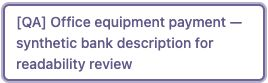
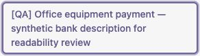

# Bank-label review captures

Captured on 14 October 2026 against the final tested source revision
`e6759dc19b8feb21d8880ae50e9b5cc146924c31`, in an isolated Odoo QA stack with
synthetic fixtures and a non-admin accounting manager.

These are cropped native payment-link details from desktop1280×900 and
mobile390×844 viewports. They show the full synthetic bank description and
native keyboard focus. The crop excludes amounts, bill references and surrounding
financial fields. The screenshots illustrate layout; actual pointer and Enter
navigation, record identity, focus and clipping were checked separately.

The owner personally inspected both images and their metadata before publication.
There are no real contacts, production records, credentials, document contents,
browser address bars or local paths. JPEG headers contain standard JFIF data,
without EXIF, ICC, comments or other embedded metadata. No redaction was needed.

