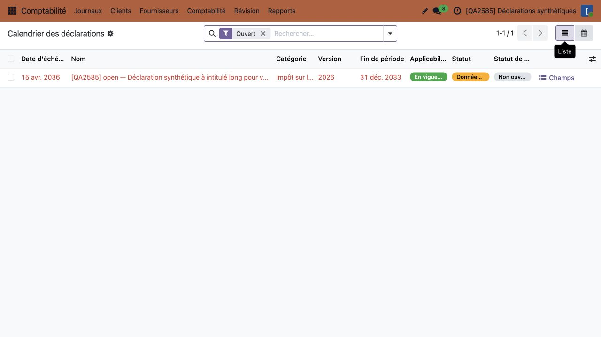
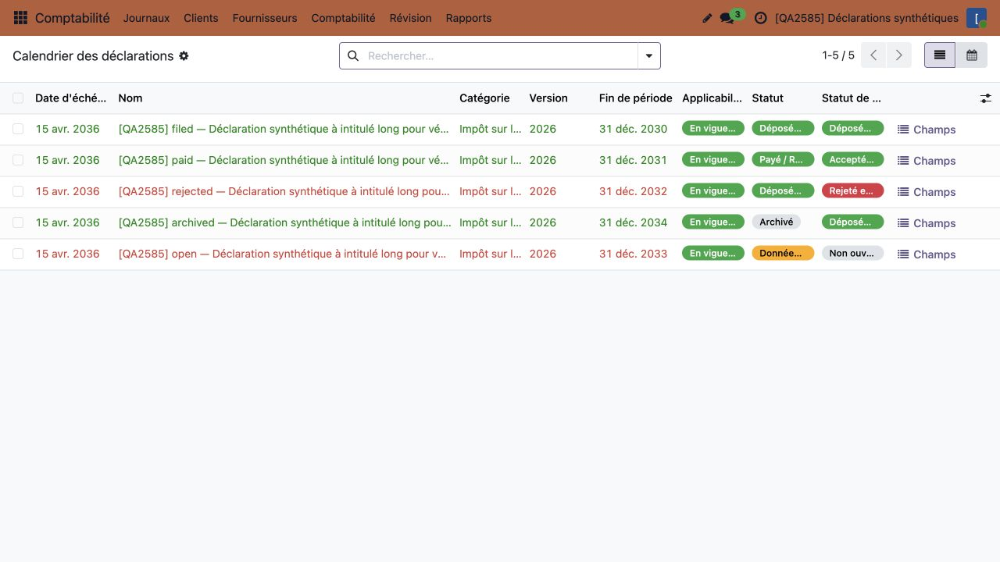
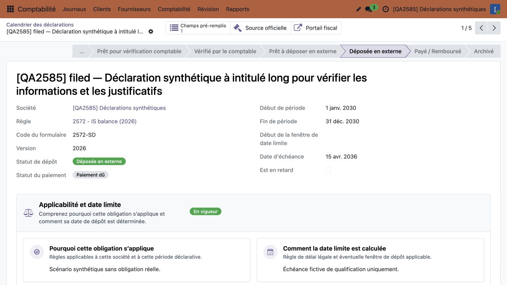
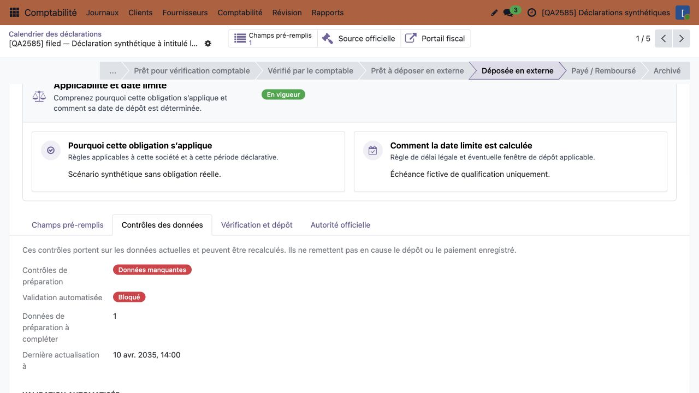
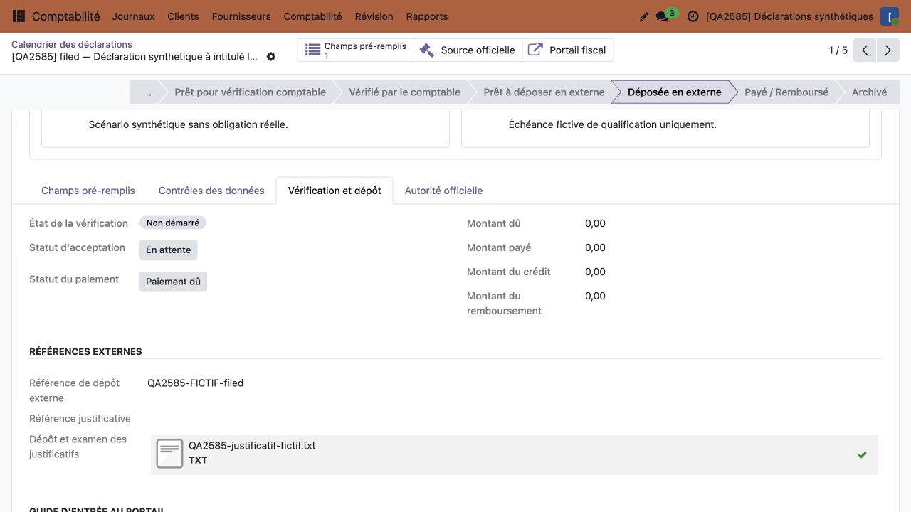
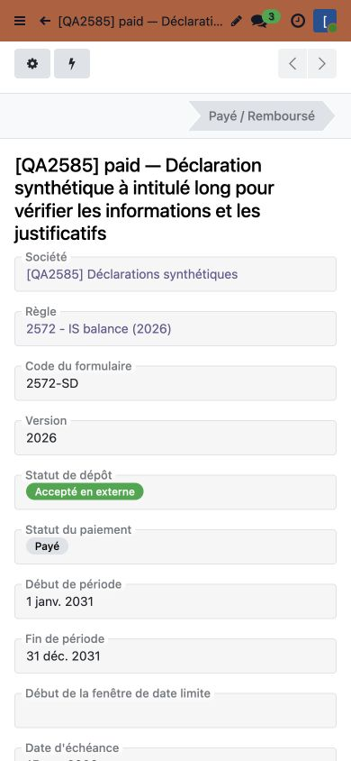
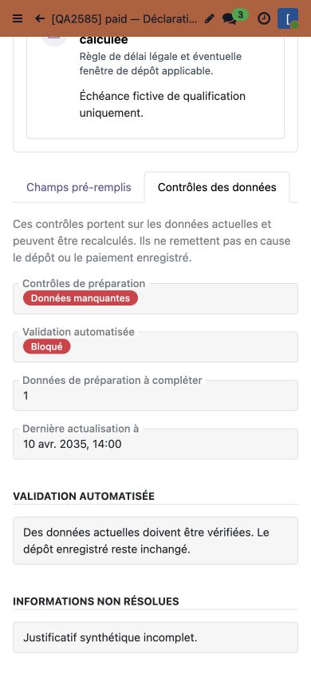
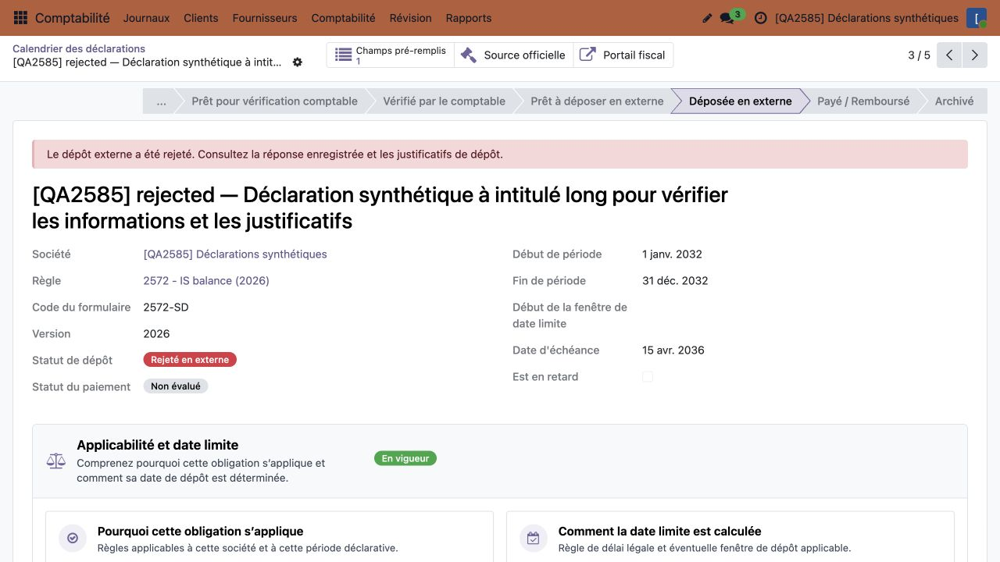
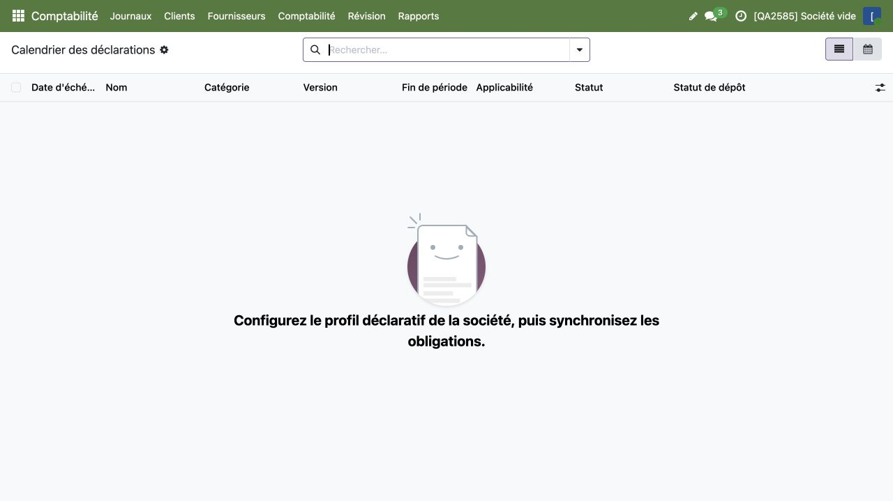

# Declaration Schedule QA captures

Captured 17 October 2026 (Europe/Paris) from final product source `0dd6e19cf7ef2880cd3d5a94479916c30fb76d89`, Rebuild `saas~19.3.1.13.37`. An ordinary non-admin accounting reader uses French on an isolated disposable QA registry with invented declarations and companies. Desktop is 1280×720; mobile is 390×844 browser emulation, not a physical-device claim.

The lead personally inspected every complete image and its full JPEG metadata before approving these exact hashes. The implementation owner also inspected all nine images and verified the copied bytes. Metadata is limited to JFIF APP0; there is no EXIF, XMP or comment segment. No credentials, browser address bars, local paths or private business content are present. All visible references, evidence and monetary values are synthetic. Private capture sidecars are excluded; `capture-context.json` contains safe context and exact image hashes only.

These are final product captures. Older before-state and unversioned images are excluded. Stills illustrate the hierarchy; native browser interactions, regression tests, causal rollback controls and exact history preservation establish behavior. The lead separately verified calendar navigation, Back/filter retention and company switching without editing fields or invoking financial actions. Read-only post-browser checks preserved the four canonical tables and 13 exact history tables.

## 01-v37-open-schedule.jpg

The default Open filter shows only the remaining preparation obligation.

SHA-256: `3c571c7cbc12e3150a62d22a8324e3417340a3c16d9eb9a94c98aa47bc8a34e1`.

## 02-v37-completed-and-open-history.jpg

Removing Open shows five lifecycle fixtures; completed outcomes stay green and open work or real rejection stays red.

SHA-256: `3f02cf7f65069abc41a47efec4e4341156b5845ff9011098853d2b29311476fe`.

## 03-v37-filed-primary.jpg

A filed declaration prioritizes recorded filing and payment outcomes, with the corrected French lifecycle label.

SHA-256: `795ba050c84606deb665dc4ab5d1d4f4f422b11902ba4567e5f9662962e5b73a`.

## 04-v37-current-checks-detail.jpg

Data Checks retains missing inputs, blocked validation and the explanation that these are current recalculable checks.

SHA-256: `3880ff499c79de55de6f3daf5cbfc6b2db574c4c8009bd44320ee3904d22ffca`.

## 05-v37-filing-evidence.jpg

Review and Filing retains the fictional filing reference and synthetic evidence attachment.

SHA-256: `1ed5aace05f4a349b1a1a1226e53a742108327f61168ce79bd2f3175b2d131e5`.

## 06-v37-mobile-paid-primary.jpg

On a 390 px viewport, the paid declaration prioritizes accepted filing and recorded payment.

SHA-256: `aa81ed7c5a13d0d12ad648a7e12f93eb4ae7f4ab553f6f26576ead9e0e137653`.

## 07-v37-mobile-current-checks.jpg

The same mobile declaration retains current missing-data and validation details with the explanatory copy.

SHA-256: `27561662d29dd0c78458718412cbab81c7ed9d637a70f511ae85a5678b3e8937`.

## 08-v37-external-rejection.jpg

An actual external rejection remains prominent even when the lifecycle is filed.

SHA-256: `ee5662daa22518a0ee2be5fe2ca80ce6c21ace0b18c143a5ab71621ae9e9e62b`.

## 09-v37-empty-company.jpg

An empty synthetic company shows the native empty schedule with all filters removed.

SHA-256: `cdedc5de166d494969b4cb74db14cc0621308b447cf47f6fe030cd20e64edeee`.
