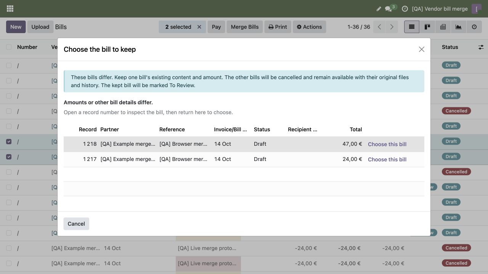
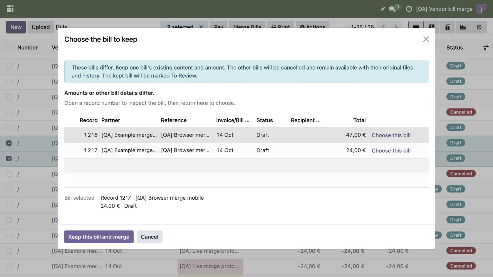
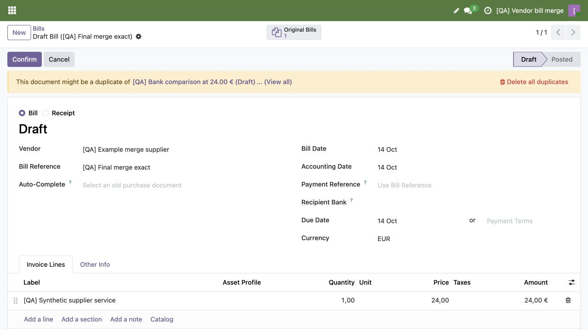
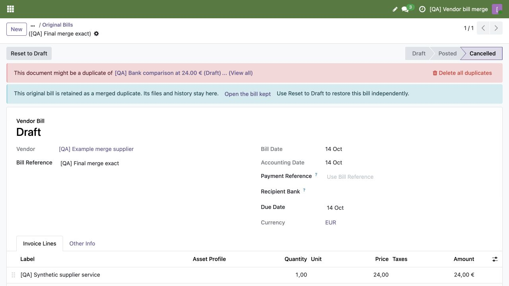
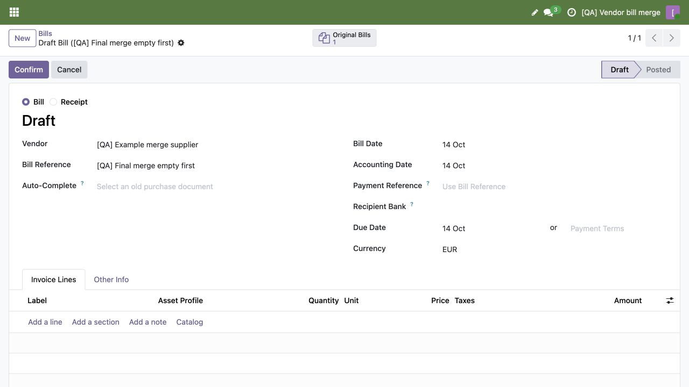
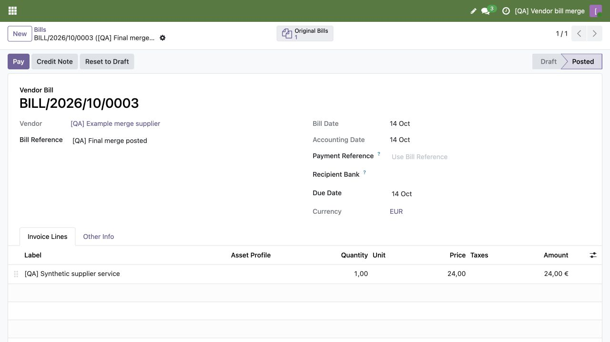
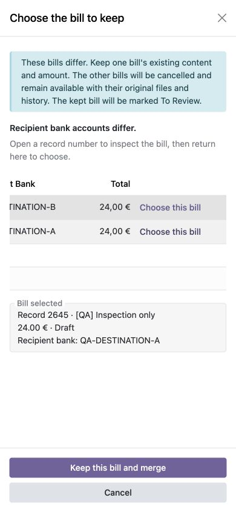
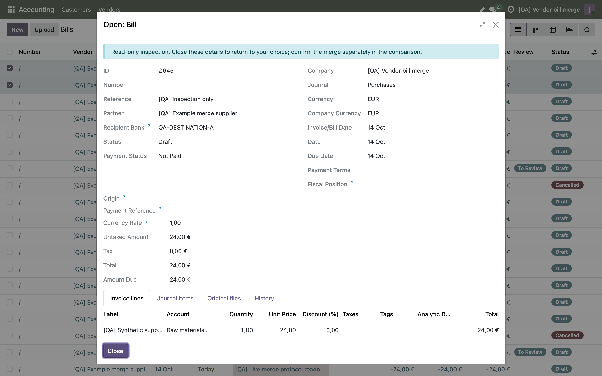
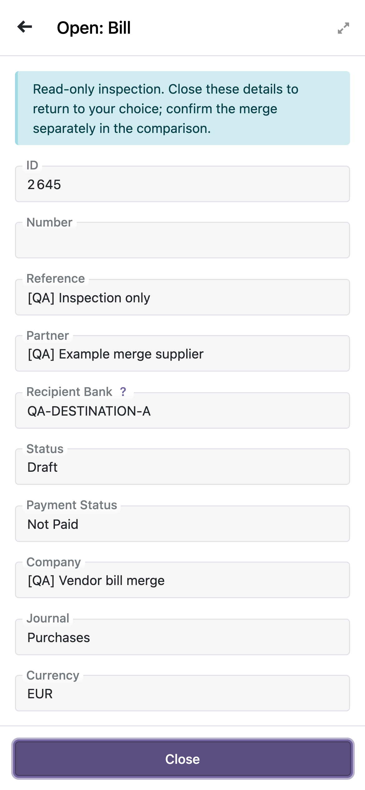

# Vendor bill duplicate merge

Captured 14 October 2026 (Europe/Paris) in isolated disposable QA with an ordinary non-admin Billing user. All company, supplier, bank, bill and document values are invented. Final tested product revision: `01986ebf9f2a3e4b7244e468ac255f68970f27cb`.

The lead and implementation owner personally inspected the published pixels and metadata. JPEG files contain only JFIF APP0 metadata; PNG files contain only IHDR, IDAT and IEND chunks. No private sidecars or browser logs are published.

Root desktop captures use 1280×720; the owner desktop inspection uses 1440×900 at DPR2. Mobile captures use 390×844; the owner inspection uses DPR3. Mobile comparison uses horizontal scrolling and inspection uses vertical scrolling. Browser mobile evidence is not a physical-device claim.

Still images illustrate layout. Actual native desktop journeys cover empty/exact/posted/conflicting merges and independent recovery. Native mobile journeys cover inspection, selection and Cancel, not a mobile merge. Native tests and cross-request persistent checks provide the functional and financial evidence.

## vendor-root-conflict-choice-01986.jpg

Different amounts require a choice; each row identifies the bill before selection.

SHA-256: `470a6691be5dafb3b65f48e5e45ee6424cf4d9eb0872ed7c3b37e8ce71c472a8`.

## vendor-root-conflict-selected-01986.jpg

Choosing a row exposes its full identity and amount; merge requires separate confirmation.

SHA-256: `fbad328519dd3b866e8c9f7a3c087437e54cbca9ce2b9120f99a1d6e8fdb96b2`.

## vendor-root-exact-retained-01986.jpg

Exact duplicates retain the first bill and its original amount; Original Bills opens the cancelled source.

SHA-256: `b3fdbd8a32e0d45f97539fde9c96a592dd15cffb5d8d24a33683af24088bfcc5`.

## vendor-root-original-recovery-01986.jpg

A cancelled original retains navigation, files and history, with native Reset to Draft for independent recovery. This image precedes the separately verified reset.

SHA-256: `c03583758c5ef7a21b79a656ed0e67725fea95a2275a1121913cd7e0e11dfd61`.

## vendor-root-empty-retained-01986.jpg

Same-supplier empty bills retain the first empty bill without a choice prompt.

SHA-256: `9fbac02bcfea4afb15b0a586db4c7e8def3c9e290cb196c0d081efb14761d506`.

## vendor-root-posted-retained-01986.jpg

The eligible posted winner remains posted with its existing amount and Original Bills navigation.

SHA-256: `10a0169740fa1f12831edc4529f20209efbb978874c565249e68ba87c368c8be`.

## vendor-root-mobile-selected-01986.jpg

Mobile comparison is horizontally scrolled to amount/bank selection; the full selected record, amount, state and bank remain visible above separate confirmation and Cancel.

SHA-256: `c06b7dddfa394896ec643d292db8880e6cd4ce73e59538346ef0bbe16e17a983`.

## vendor-merge-inspection-details-desktop.png

Comparison-only inspection shows financial facts and lines without lifecycle actions; original files and readable history remain available in native tabs.

SHA-256: `6ca167bf35189e46333cbb6d1204a245599a2c04974cf21cae3474efbbff8660`.

## vendor-merge-inspection-details-mobile.png

Mobile inspection scrolls vertically while the native Close footer remains reachable; closing returns to the comparison.

SHA-256: `1e460c949b6fda52203048ba3f895a911ff736af21186518db2b840816cafc74`.
