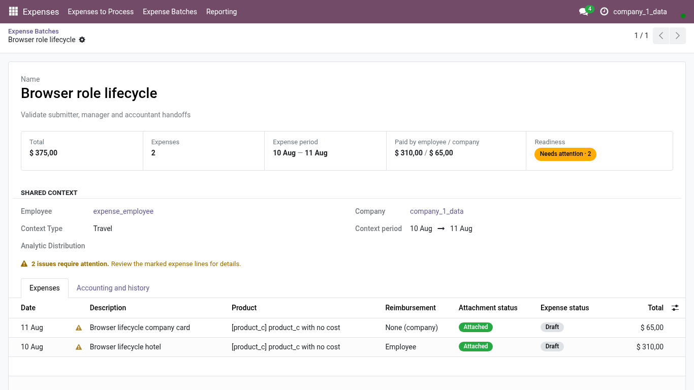
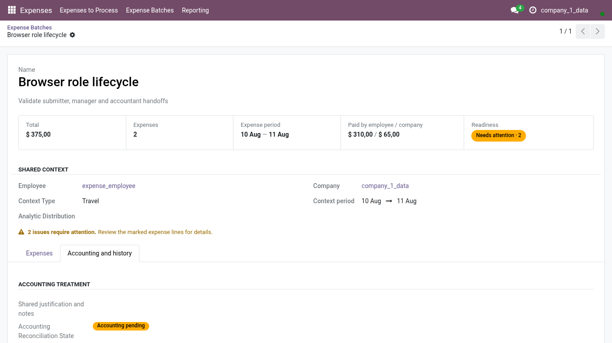

<!-- Generated from the journey named in the front matter. Change the test, then run `make docs`. -->

# Audit a Batch as a read-only accountant

Read everything about a Batch, its lines, its receipts and its accounting, without being able to change any of it.

1. Open **Expenses > Batches** and choose the Batch. With read-only accounting access you see the summary, the lines and their receipts exactly as the employee and the manager do.

   

2. No lifecycle button and no line action is shown: nothing you do here can submit, approve, post or move an expense.

3. Open the **Accounting and history** tab.

4. The reconciliation state of the Batch and its history are visible and locked. Use them to answer an audit question or to prepare a remark for the accountant who can act.

   
