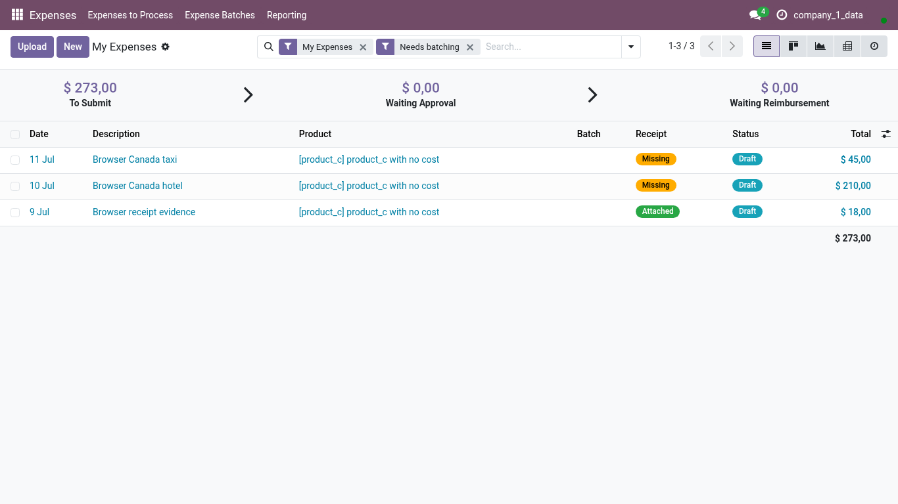
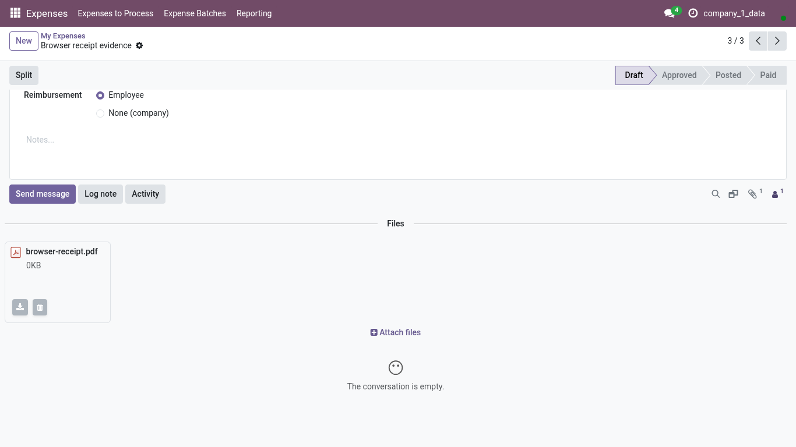

<!-- Generated from the journey named in the front matter. Change the test, then run `make docs`. -->

# Check the receipt attached to an expense

Find the receipt behind an expense, open it, and confirm who paid before the expense goes into a Batch.

1. Open **Expenses > My Expenses**. **Upload** adds a receipt and creates its expense in one go; expenses that already have a receipt are listed with it.

   

2. Open the expense you want to check.

3. The paper-clip counter in the chatter says how many files the expense carries. Choose it.

4. The receipt is listed under **Files**, below the expense. Open it and check that it is the right document and that it is readable.

   

5. Check **Paid by**: your own money is reimbursed to you, a company card is settled by the company. Change it here if the receipt says otherwise.
