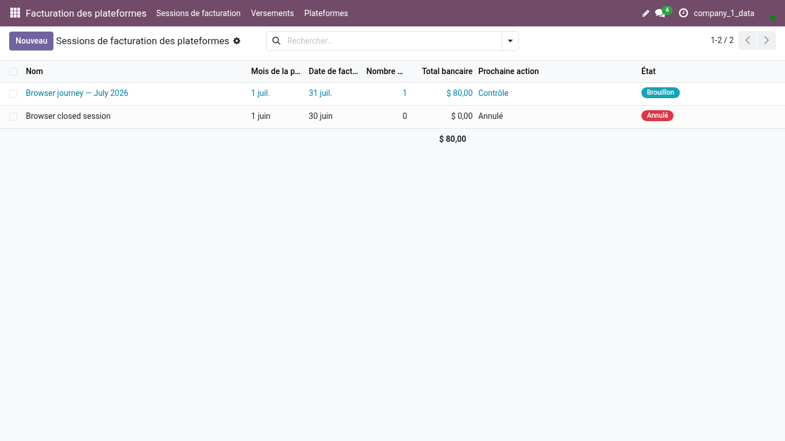
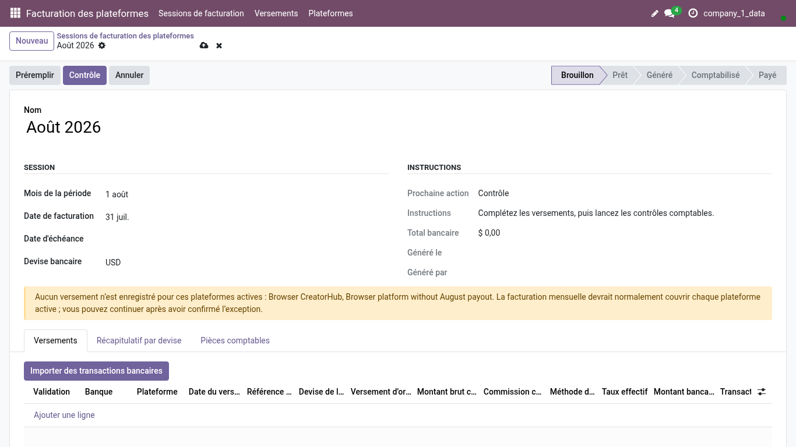
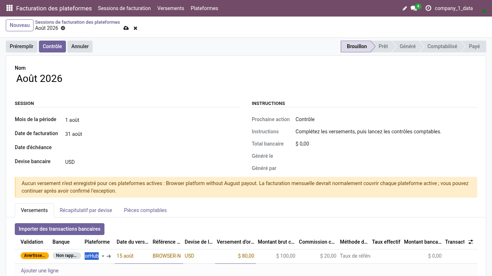
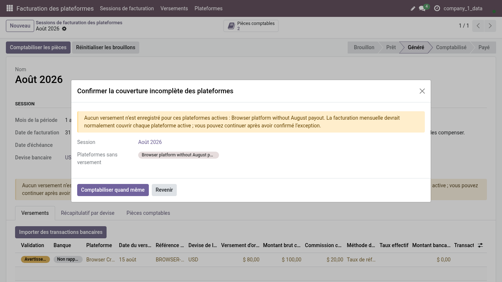
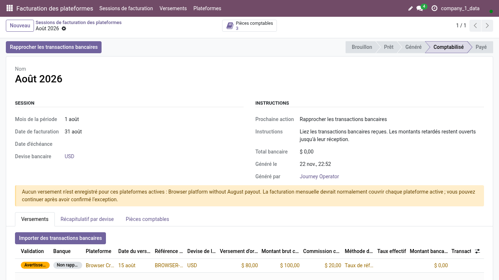

<!-- Generated from the journey named in the front matter. Change the test, then run `make docs`. -->

# Comptabiliser les versements mensuels des plateformes

Saisissez les montants déclarés par les plateformes et comptabilisez les pièces du mois, y compris lorsque le versement bancaire reste à recevoir.

1. Ouvrez **Facturation des plateformes > Sessions de facturation**. Consultez les sessions existantes pour vérifier que le mois reste à traiter.

   

2. Cliquez sur **Nouveau**.

3. Choisissez le premier jour du mois à traiter. Odoo donne à la session le nom du mois. Vérifiez la date de facturation et choisissez le dernier jour du mois si la date précédente est encore affichée.

   

4. Ajoutez une ligne pour chaque versement déclaré par une plateforme au cours du mois.

5. Choisissez la plateforme et indiquez la date, la référence et le montant net figurant sur son relevé. Odoo calcule le montant brut et la commission à partir du taux de la plateforme.

   

6. Cliquez sur **Contrôle**. Odoo enregistre la session et vérifie les plateformes, les journaux, les produits et les montants nécessaires à la facturation.

7. Cliquez sur **Générer les brouillons**. Chaque versement donne lieu à une facture de vente pour la recette et à une facture fournisseur pour la commission.

8. Vérifiez les pièces puis cliquez sur **Comptabiliser les pièces**.

9. Si une plateforme active n’a aucun versement ce mois-ci, Odoo indique son nom. Revenez à la saisie si une ligne manque.

   

10. Confirmez si l’absence est attendue, par exemple pour une plateforme qui paie chaque trimestre.

11. La session et les pièces sont comptabilisées. Un versement encore absent de la banque reste ouvert.

   

12. Lorsque l’encaissement apparaît sur le relevé, revenez dans la session pour **Rapprocher les transactions bancaires**.
