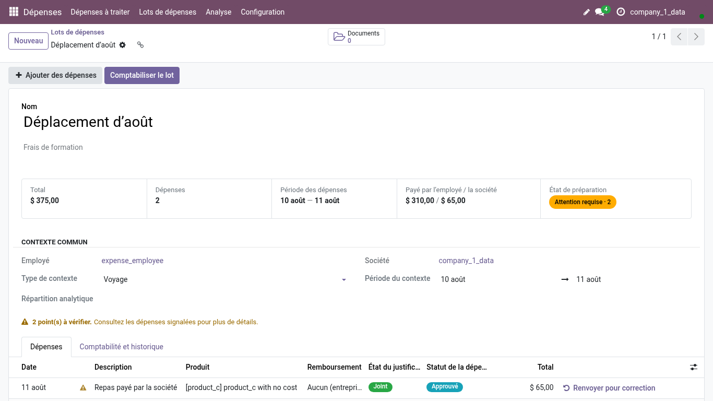
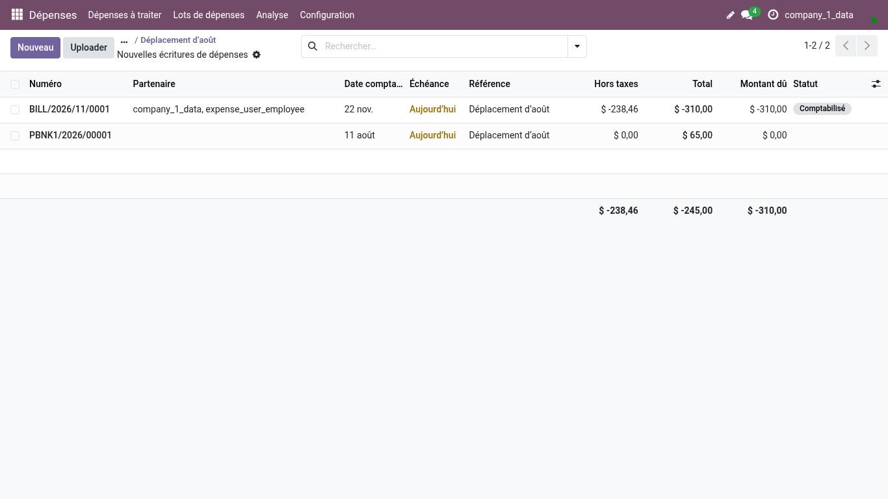

<!-- Generated from the journey named in the front matter. Change the test, then run `make docs`. -->

# Comptabiliser un lot de dépenses approuvé

Enregistrez les frais réglés par la société et le remboursement dû au salarié, puis retrouvez les deux écritures.

1. Dans **Dépenses > Lots de dépenses**, ouvrez le lot approuvé. Vérifiez les montants payés par la société et par le salarié.

   

2. Cliquez sur **Comptabiliser le lot**. Odoo comptabilise les frais réglés par la société et ouvre la fenêtre de comptabilisation des avances du salarié.

3. Vérifiez le journal et la date proposés, puis cliquez sur **Comptabiliser les dépenses**.

4. Vérifiez les deux écritures. L’une correspond aux frais réglés par la société, l’autre au remboursement dû au salarié. Chacune renvoie au lot.

   
