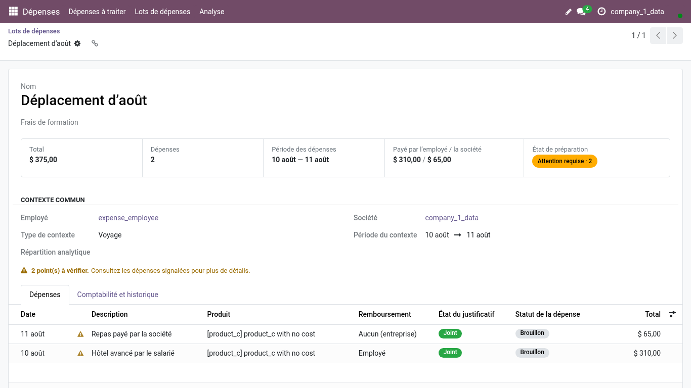
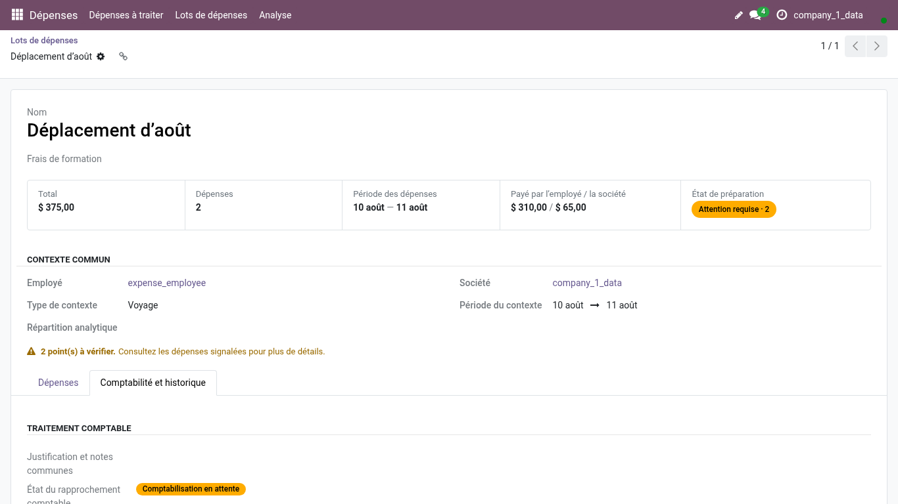

<!-- Generated from the journey named in the front matter. Change the test, then run `make docs`. -->

# Contrôler un lot de dépenses en lecture seule

Consultez les dépenses, leurs justificatifs et leur état de rapprochement avec les droits de lecture comptable.

1. Dans **Dépenses > Lots de dépenses**, ouvrez le lot à contrôler. Consultez son récapitulatif, ses lignes et les justificatifs associés.

   

2. Avec les droits de lecture comptable, vous pouvez examiner le lot à toutes les étapes. Les actions de soumission, d’approbation, de comptabilisation et de retrait restent réservées aux personnes habilitées.

3. Ouvrez l’onglet **Comptabilité et historique**.

4. Lisez l’état du rapprochement et l’historique. Si une correction est nécessaire, indiquez le lot et la ligne concernés à la personne chargée de la comptabilisation.

   
