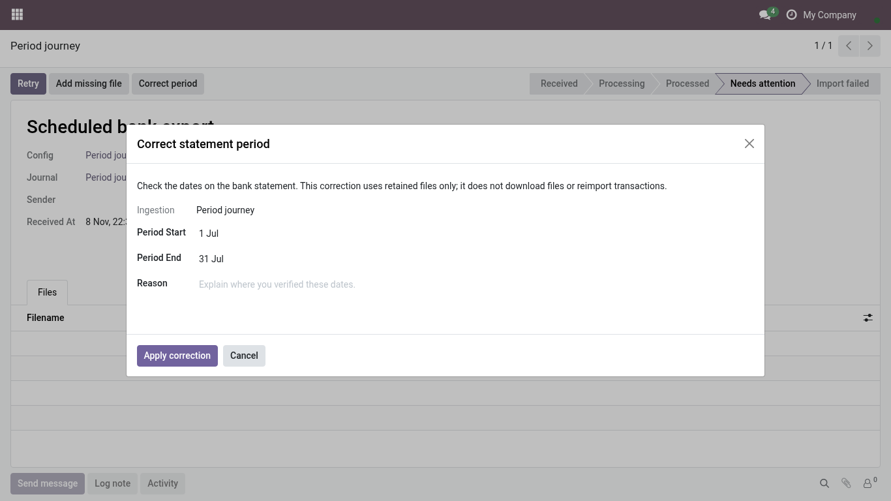
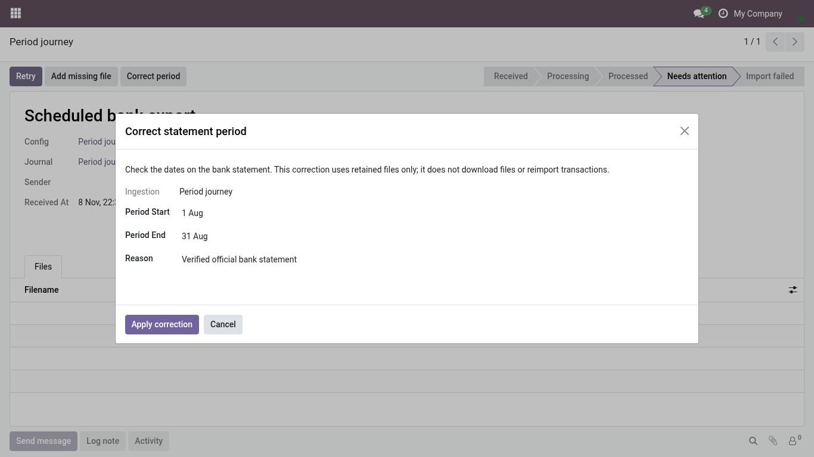
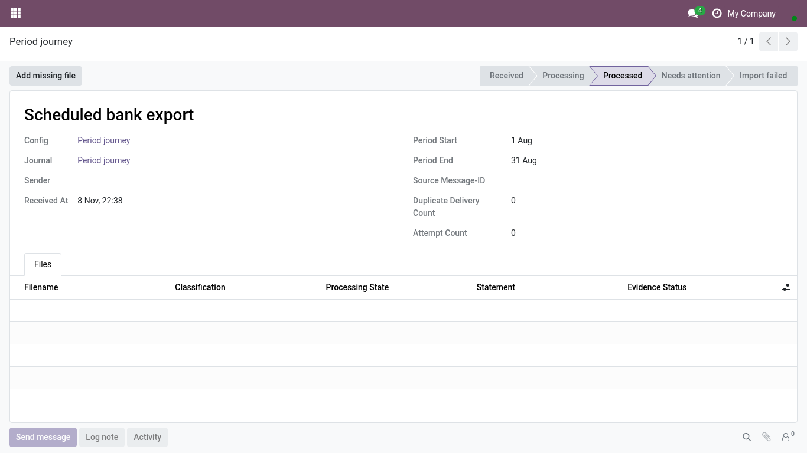

<!-- Generated from the journey named in the front matter. Change the test, then run `make docs`. -->

# Correct the period of an imported bank statement

When an imported bank export covers other dates than Odoo read, set the right period and say why, so the import can continue and the history shows the correction.

1. Open **Accounting > Configuration > Bank Statement Email Setup**, choose the bank, and open the received export that reads **Needs attention** in its list; the activity on the bank journal points to the same record. Choose **Correct period**.

   

2. Set the **start** and **end** of the period the statement really covers.

3. Write the **reason**, for example what the official statement says. It is posted in the import's history with your name.

   

4. Choose **Apply correction**.

5. The import shows the corrected period and continues from there.

   
