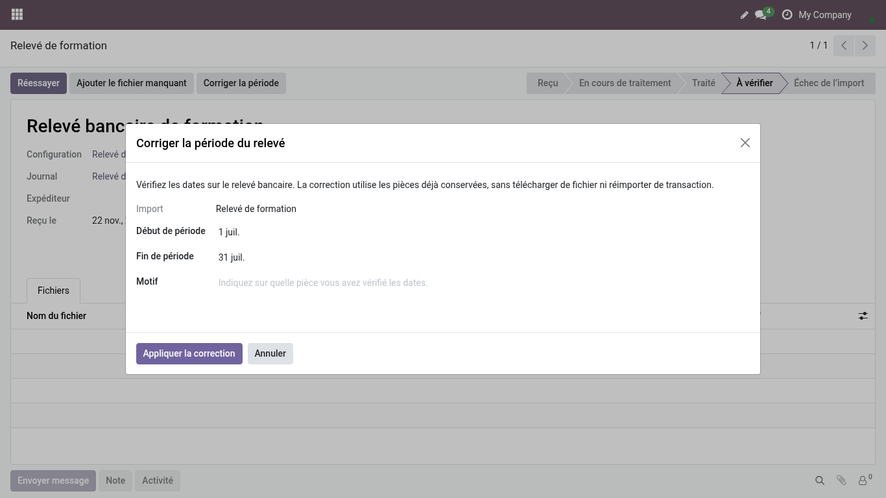
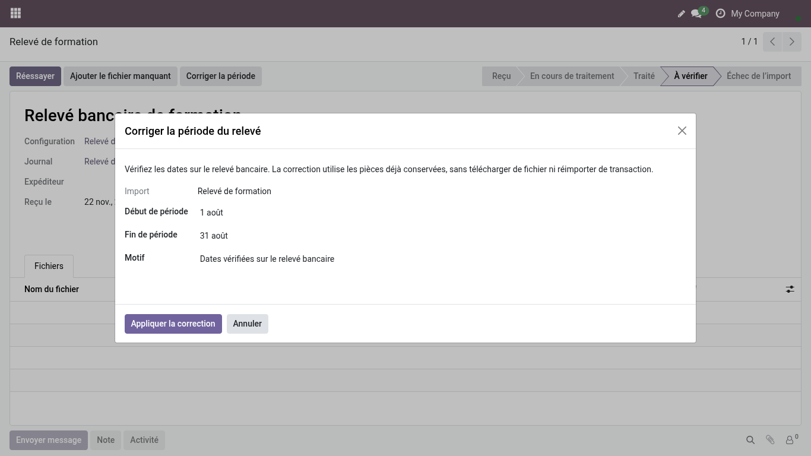
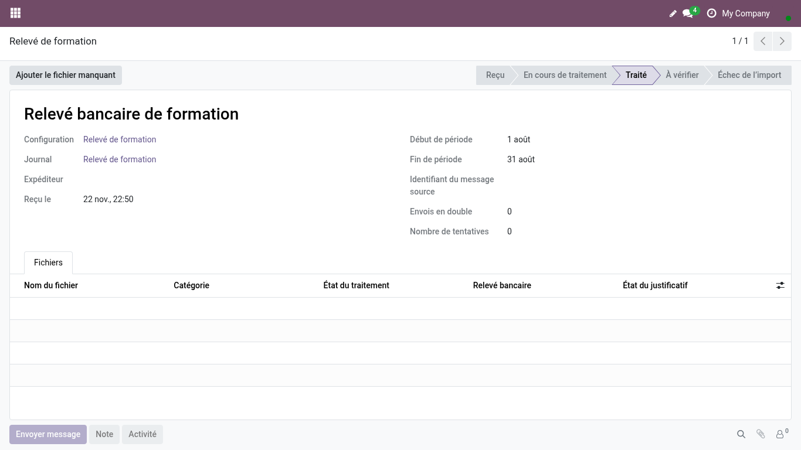

<!-- Generated from the journey named in the front matter. Change the test, then run `make docs`. -->

# Corriger la période d’un relevé bancaire importé

Renseignez les dates figurant sur le relevé et consignez la raison de la correction pour que l’import puisse reprendre.

1. Ouvrez l’import depuis l’activité du journal bancaire. Si vous gérez la configuration, vous le retrouvez aussi dans **Comptabilité > Configuration > Configuration des e-mails de relevés bancaires**. Ouvrez l’import à vérifier, puis cliquez sur **Corriger la période**.

   

2. Recopiez les dates de début et de fin qui figurent sur le relevé.

3. Indiquez sur quelle pièce vous avez vérifié les dates. Le motif de correction figurera dans l’historique de l’import avec votre nom.

   

4. Vérifiez les deux dates, puis cliquez sur **Appliquer la correction**.

5. Relisez la période sur la fiche d’import. Odoo peut poursuivre le traitement avec les dates corrigées.

   
