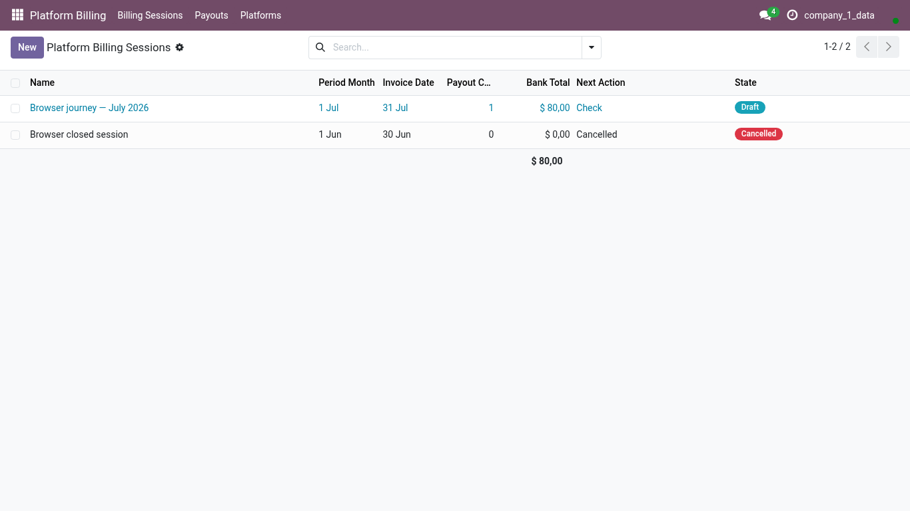
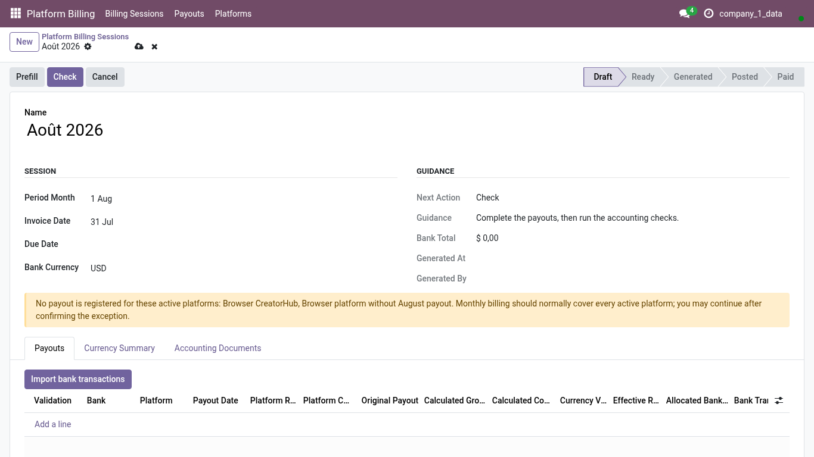
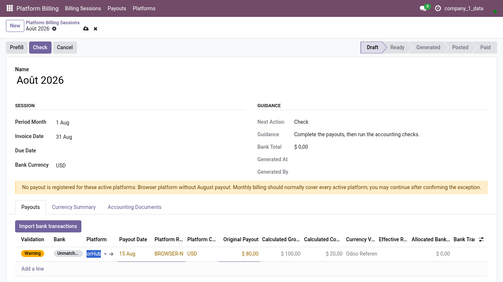
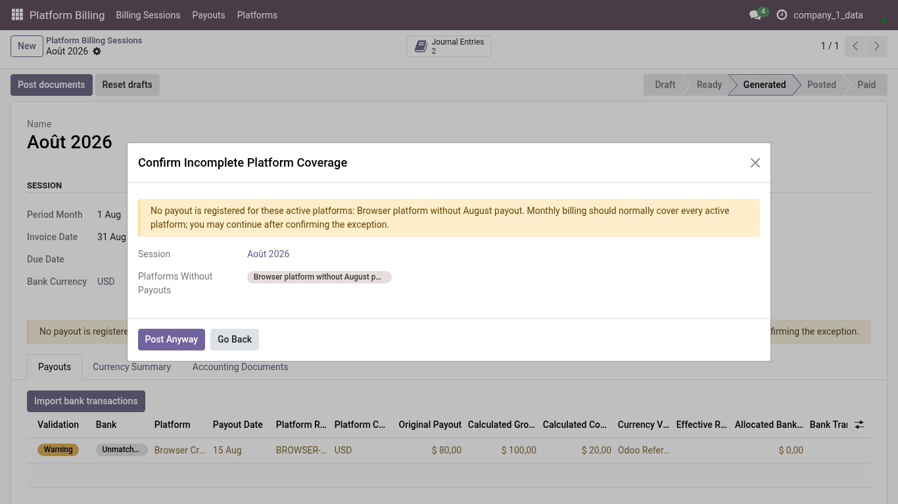
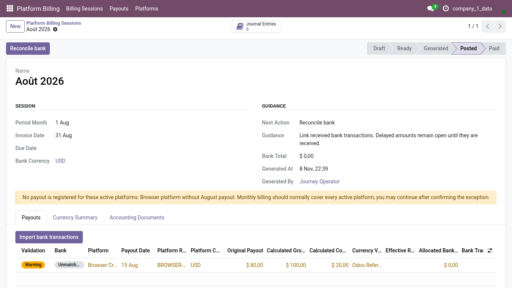

<!-- Generated from the journey named in the front matter. Change the test, then run `make docs`. -->

# Create and post a monthly platform billing session

Open the month, enter the payout each platform reported, run the checks, generate the invoices and bills and post them, even when a platform has not paid yet.

1. Open **Platform Billing > Billing Sessions**. The list shows every month, closed ones included, so you can see what was done before.

   

2. Choose **New**.

3. Pick the **billing period**: the first day of the month you are closing. Odoo names the session after the month, in French as the history always has, and proposes the month-end as invoice date.

   

4. Under **Payouts**, choose **Add a line** for each platform that reported a payout this month.

5. Pick the platform, the payout date and the platform's own reference, then enter the **net amount** the platform reported. The gross revenue and the commission are derived from the platform's rate.

   

6. Choose **Check**. The session is saved and the accounting checks run: platforms, journals, products and amounts must all be in place before anything is generated.

7. Choose **Generate drafts**: one customer invoice for the revenue and one bill for the commission, per payout, in draft.

8. Choose **Post documents**.

9. When an active platform has no payout this month, Odoo says which one before posting. This is the moment to add a forgotten line.

   

10. Confirm when the gap is deliberate, for example a platform that pays quarterly.

11. The session is **Posted**. A payout whose money has not arrived stays open; the invoice is posted and waits for the bank.

   

12. **Reconcile bank** stays available: come back when the receipt shows on the bank statement.
