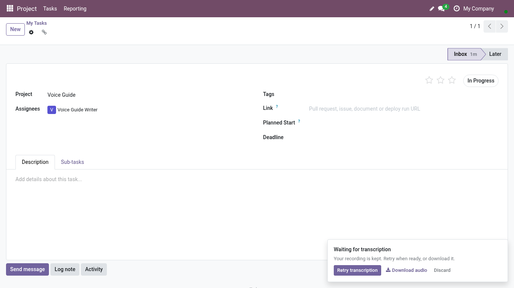
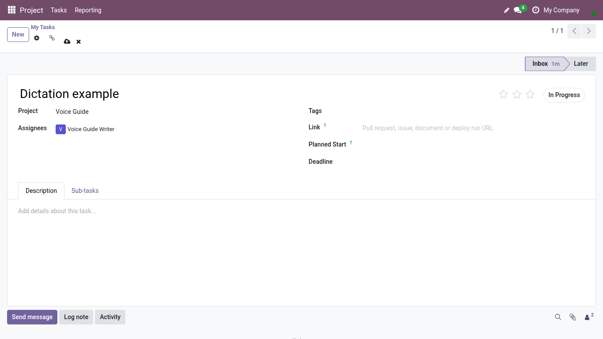
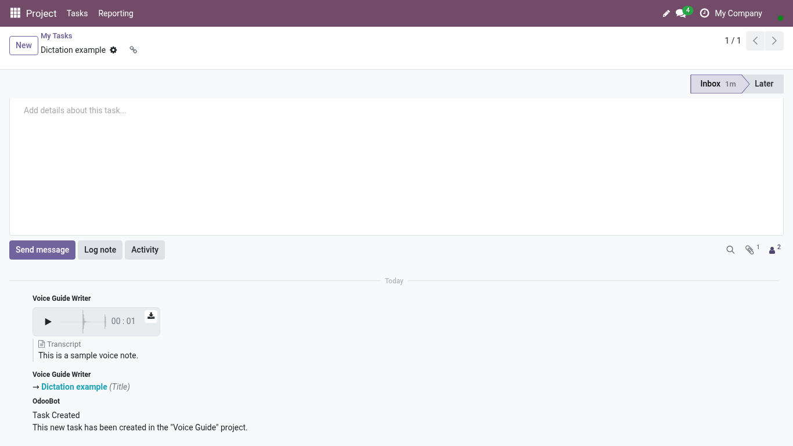

<!-- Generated from the journey named in the front matter. Change the test, then run `make docs`. -->

# Dictate into a field or record a voice note

Turn speech into text in an Odoo field, or share a voice note and its transcript in the chatter.

1. To dictate text, place the cursor in an editable field.

2. Choose the microphone or press **Alt+Shift+D**. Speak in French or English.

3. Choose **Stop** when you finish speaking.

4. If transcription fails or takes too long, choose **Retry transcription** or **Download audio**. A recording saved locally can reappear under **Unused dictation** in the same browser and database. If browser storage is unavailable, download the audio before closing the tab.

   

5. Check the inserted text before saving or sending it. If you switched fields while waiting, choose **Copy transcript** and paste the text where it belongs.

   

6. To share an audio recording, open the record’s chatter. Choose **Log note** for internal readers or **Send message** to send it as a message.

7. Choose **Record a voice note**, the waveform icon, and speak.

8. Choose **Stop and preview**.

9. Listen to the draft recording. If it is already attached to a saved draft, reopen that draft to send or remove it.

10. When the recording is ready, post the note or send the message.

11. Readers with access can play the audio. Once processing finishes, they can read **Transcript** under the message. The transcription service receives the audio. The record and surrounding message stay in Odoo.

   
