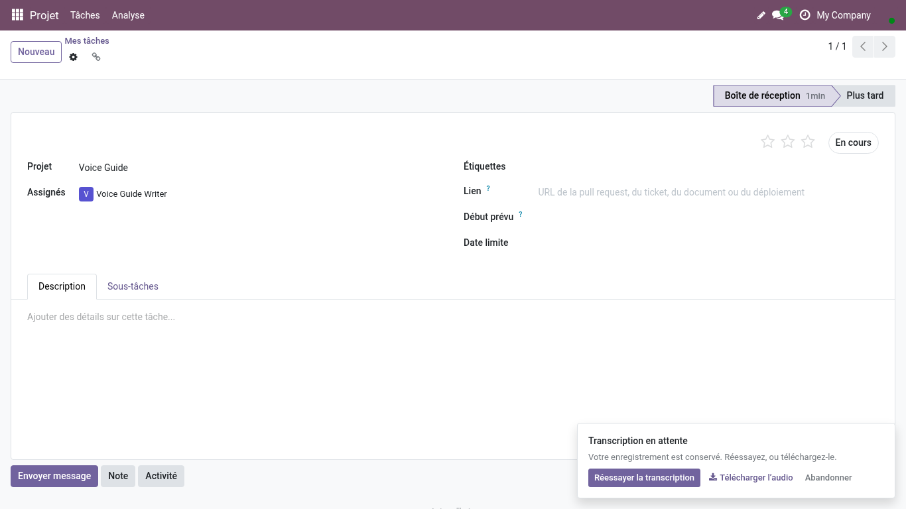
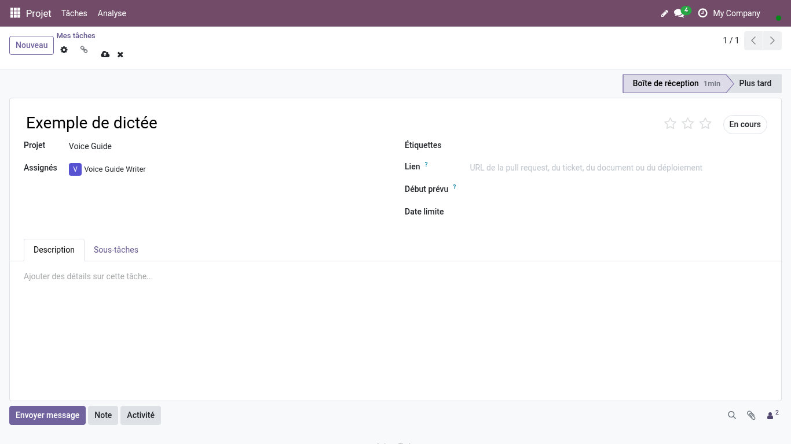
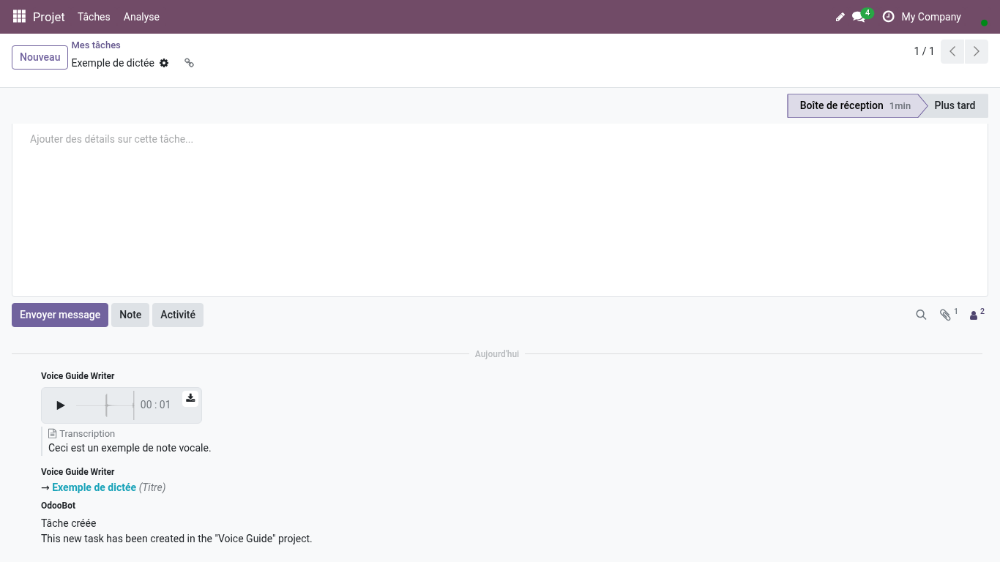

<!-- Generated from the journey named in the front matter. Change the test, then run `make docs`. -->

# Dicter dans un champ et envoyer une note vocale

Transformez la parole en texte dans un champ Odoo, ou partagez un vocal et sa transcription dans le fil d’une fiche.

1. Pour dicter du texte, placez le curseur dans un champ modifiable.

2. Sélectionnez le microphone ou appuyez sur **Alt+Maj+D**. Parlez en français ou en anglais.

3. Arrêtez la dictée lorsque vous avez fini de parler.

4. Si la transcription échoue ou tarde, choisissez **Réessayer la transcription** ou **Télécharger l’audio**. Un enregistrement conservé localement peut réapparaître sous **Dictée non utilisée** dans le même navigateur et la même base. Si le navigateur ne peut pas le conserver, téléchargez l’audio avant de fermer l’onglet.

   

5. Relisez le texte inséré avant de l’enregistrer ou de l’envoyer. Si vous avez changé de champ pendant l’attente, copiez la transcription et collez-la à l’endroit voulu.

   

6. Pour partager un enregistrement, ouvrez le fil de la fiche. Choisissez **Note** pour un partage interne ou **Envoyer message** pour écrire aux destinataires du message.

7. Choisissez **Enregistrer une note vocale**, l’icône en forme d’onde, puis parlez.

8. Arrêtez l’enregistrement pour afficher l’aperçu.

9. Écoutez l’enregistrement. S’il est déjà joint à un brouillon, rouvrez ce brouillon pour l’envoyer ou le retirer.

10. Quand l’enregistrement est prêt, publiez la note ou envoyez le message.

11. Les personnes qui ont accès au message peuvent écouter l’audio. Après le traitement, elles peuvent lire la **Transcription** sous le message. Le service de transcription reçoit l’audio. La fiche et le reste du message restent dans Odoo.

   
