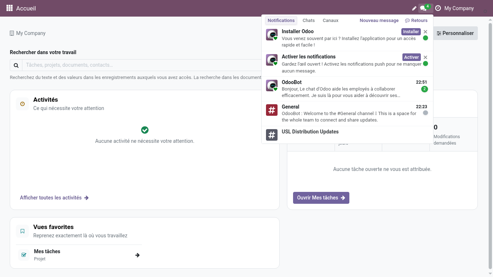
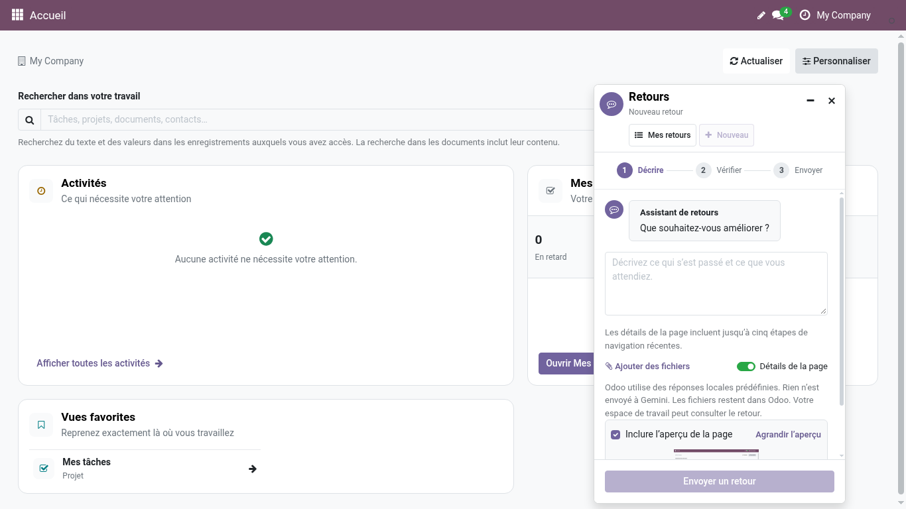
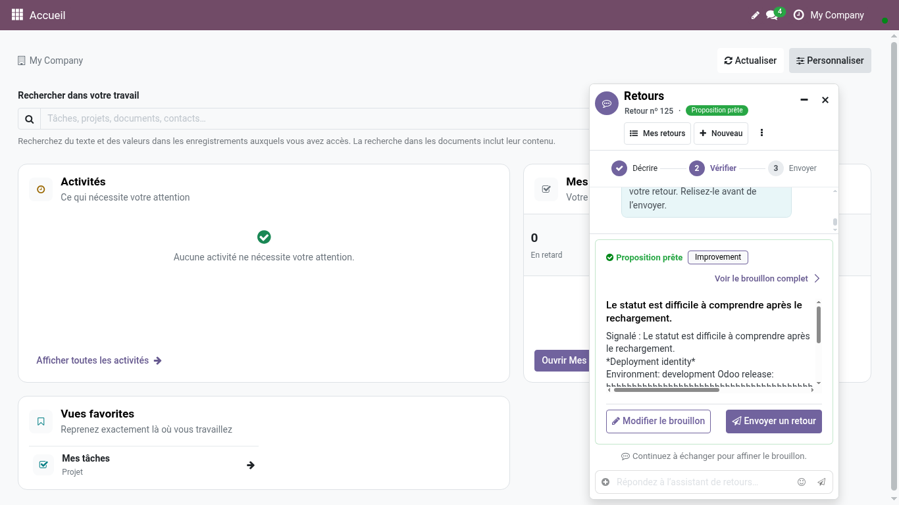
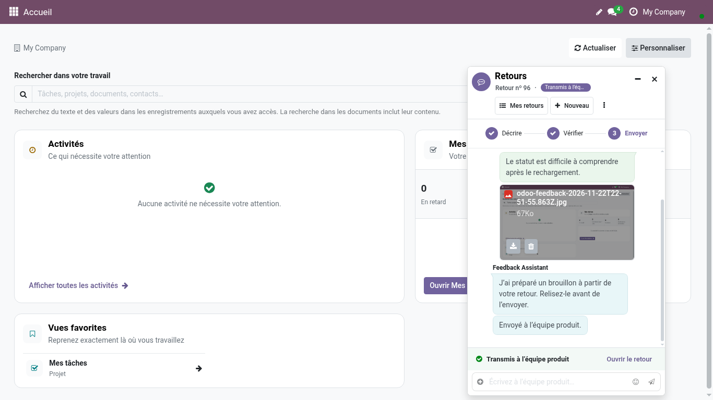
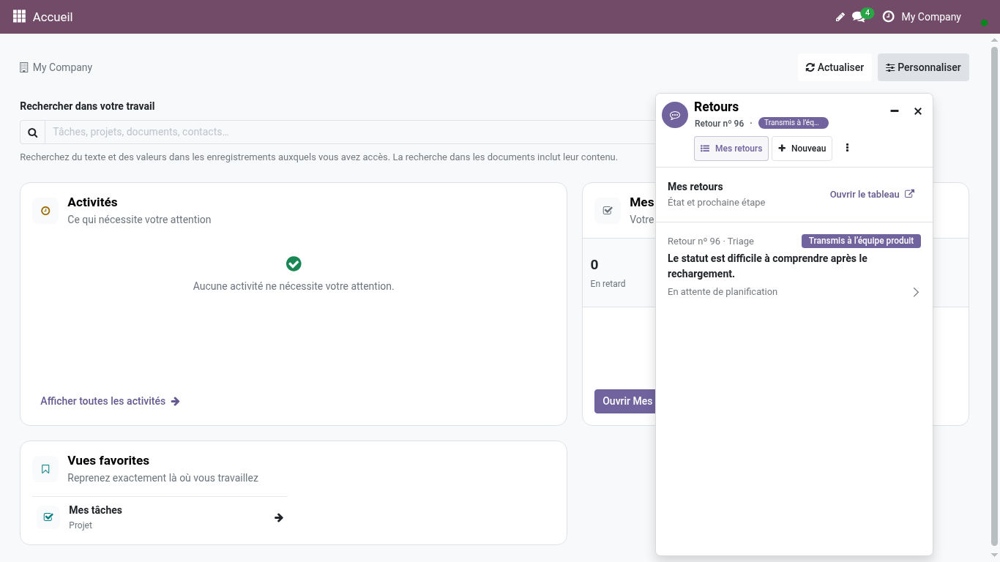

<!-- Generated from the journey named in the front matter. Change the test, then run `make docs`. -->

# Envoyer un retour depuis une page Odoo

Signalez une difficulté, proposez une amélioration ou posez une question depuis la page concernée, puis retrouvez les réponses de l’équipe produit.

1. Ouvrez **Messages** dans la barre du haut. Le bouton de retour se trouve à côté de **Nouveau message**, dans chaque onglet.

   

2. Cliquez sur le bouton de retour.

3. Une conversation s’ouvre. Odoo prépare un aperçu de la page. Il reste sur votre appareil jusqu’à ce que vous choisissiez de l’envoyer.

   

4. Décrivez ce que vous vouliez faire, puis ce que vous avez observé.

5. Vérifiez **Détails de la page**. Cette option joint la page de travail, la fiche accessible, la société et la version. Décochez-la si la page n’aide pas à comprendre le retour.

6. Cliquez sur **Envoyer un retour** pour démarrer la conversation. L’assistant prépare un brouillon à relire.

7. Relisez le brouillon dans la conversation. Vous pouvez ajouter une précision ou modifier le texte avant de le transmettre à l’équipe produit.

   

8. Lorsque le brouillon exprime bien votre demande, cliquez sur **Envoyer un retour** sur la fiche du brouillon.

9. Le bandeau confirme la transmission à l’équipe produit. Retrouvez ses réponses dans cette conversation.

   

10. Cliquez sur **Nouveau** pour préparer un autre retour. Le premier reste accessible.

11. Dans **Mes retours**, retrouvez vos demandes et leur statut.

12. Choisissez une demande pour reprendre la conversation ou ajouter une précision.

13. Revenez dans **Mes retours** pour consulter l’avancement depuis n’importe quelle page.

   
