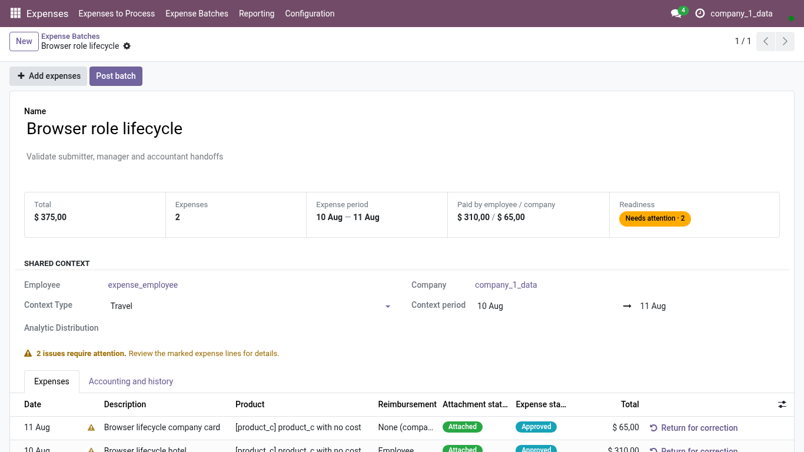
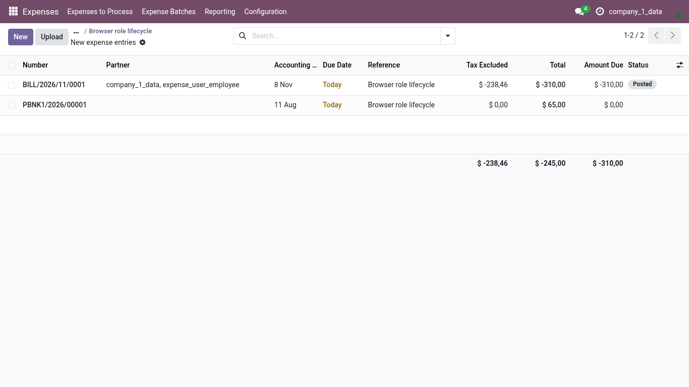

<!-- Generated from the journey named in the front matter. Change the test, then run `make docs`. -->

# Post an approved Batch

Post a Batch whose expenses the manager approved: the company-paid side first, then the employee-paid side through Odoo's own posting wizard.

1. Open **Expenses > Batches** and choose an approved Batch. **Post batch** is the primary action; the summary says how much is company-paid and how much is owed to the employee.

   

2. Choose **Post batch**. The company-paid expenses are posted at once; for the employee-paid ones Odoo opens its posting wizard.

3. Confirm **Post Expenses** in the wizard. The journal and date are the ones Odoo proposes for expense reports.

4. Both journal entries are listed: one for the company-paid side, one for the reimbursement owed to the employee. Each links back to the Batch.

   
