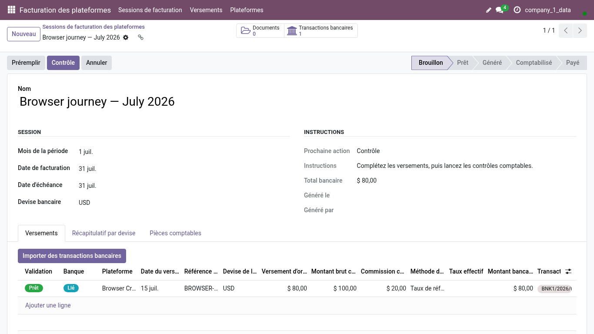
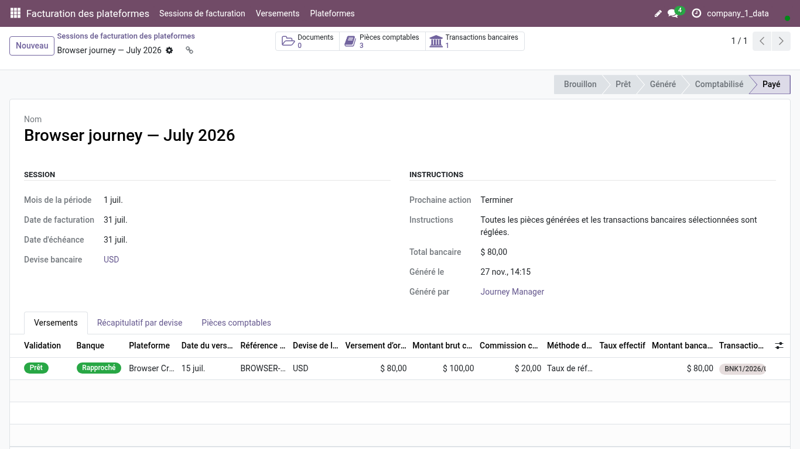
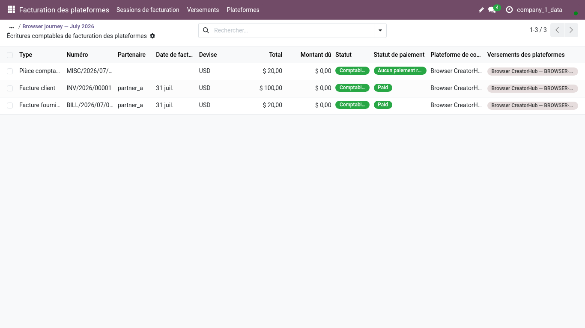

<!-- Generated from the journey named in the front matter. Change the test, then run `make docs`. -->

# Comptabiliser et rapprocher une session de facturation

À partir des versements saisis et de l’encaissement bancaire identifié, retrouvez les factures, la compensation des commissions et le règlement final.

1. Dans **Facturation des plateformes > Sessions de facturation**, ouvrez la session en brouillon. Vérifiez que les versements sont saisis et que l’encaissement bancaire est associé.

   

2. Cliquez sur **Contrôle** pour lancer les vérifications comptables.

3. Cliquez sur **Générer les brouillons**, puis vérifiez les factures de vente et les factures de commission créées.

4. Cliquez sur **Comptabiliser les pièces**. La commission est compensée avec la recette. Le montant à rapprocher correspond alors au versement net.

5. Cliquez sur **Rapprocher les transactions bancaires**. L’encaissement associé au versement solde le net.

6. Vérifiez que la session est payée. La facture de vente, la facture de commission et l’encaissement sont rapprochés.

   

7. Ouvrez **Pièces comptables** pour consulter les documents comptabilisés.

8. Ouvrez une pièce dans la liste pour retrouver ses lignes et ses références dans les rapports comptables.

   

9. La mention **Aucun paiement requis** identifie la compensation de commission. Elle ne crée pas de paiement à effectuer.
