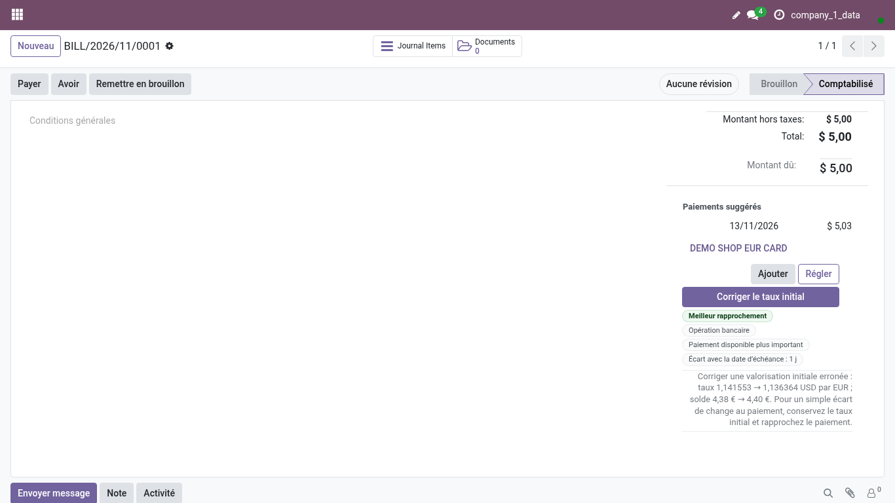
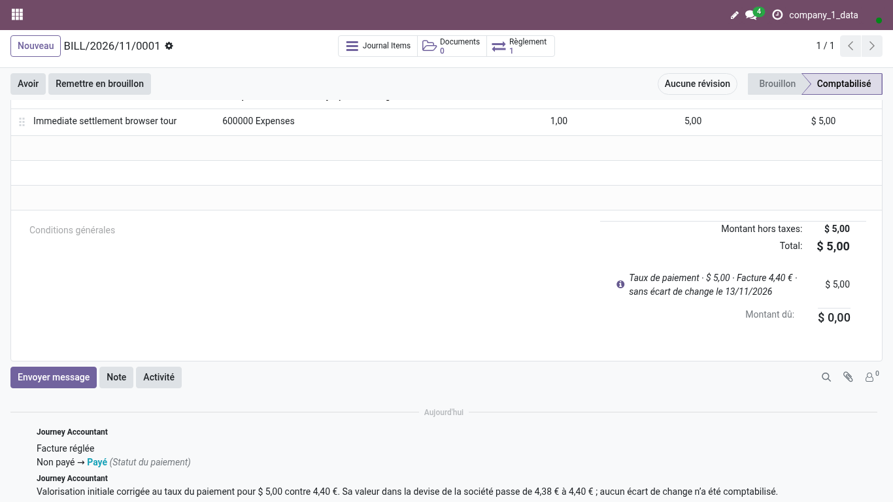
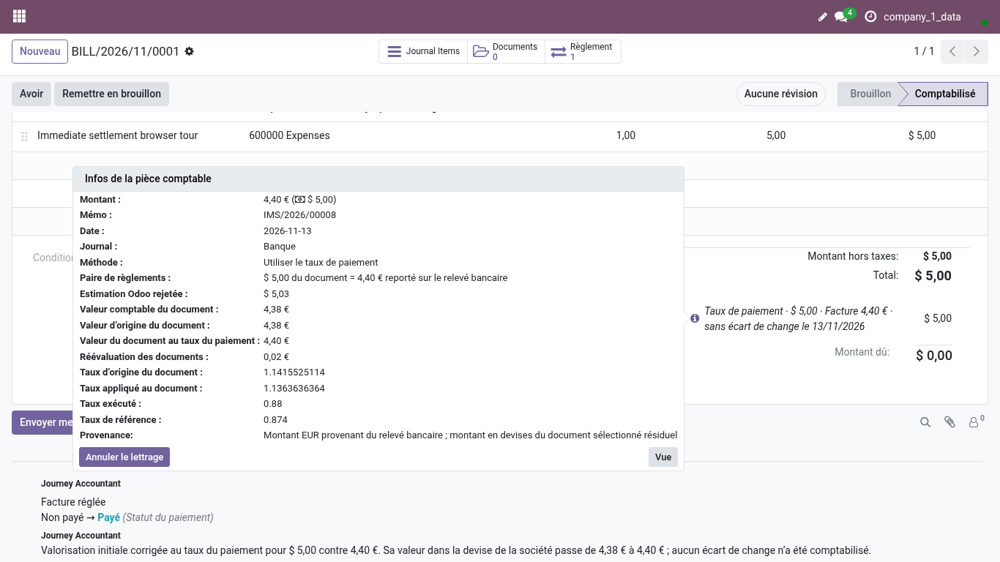

<!-- Generated from the journey named in the front matter. Change the test, then run `make docs`. -->

# Régler une facture en devise au taux du paiement

Utilisez le débit bancaire pour valoriser une facture fournisseur en devise, vérifiez le détail du règlement et retrouvez la valeur d’origine en cas d’erreur.

1. Dans **Comptabilité > Fournisseurs > Factures**, ouvrez la facture comptabilisée. Sous **Paiements suggérés**, un rapprochement éligible propose **Ajouter**, **Régler** et **Corriger le taux initial**.

   

2. Survolez la ligne **Meilleur rapprochement** ou placez-y le focus avec la touche Tab. L’infobulle indique la transaction bancaire et les éléments qui justifient le rapprochement.

3. Choisissez **Corriger le taux initial** si les justificatifs montrent que le taux était erroné à la comptabilisation. Vérifiez le taux et les montants affichés avant de cliquer. Odoo corrige la facture et la rapproche du paiement.

4. La facture passe à l’état payé. La ligne de règlement indique le taux de paiement et précise qu’aucun écart de change n’a été comptabilisé.

   

5. Cliquez sur l’icône d’information de la ligne de paiement.

6. Comparez l’estimation écartée, la valeur d’origine de la facture et sa valeur au taux du paiement. Les écritures associées permettent de retracer le règlement.

   

7. Si le rapprochement est erroné, cliquez sur **Annuler le lettrage** dans le détail du paiement.

8. La facture est de nouveau ouverte à sa valeur d’origine. Vous pouvez vérifier les trois propositions et choisir le rapprochement qui convient.
