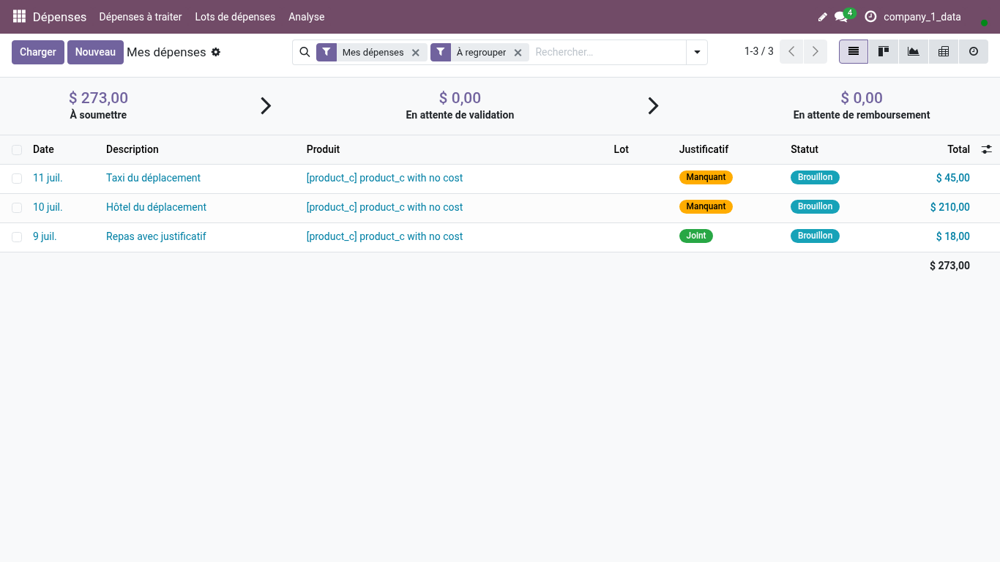
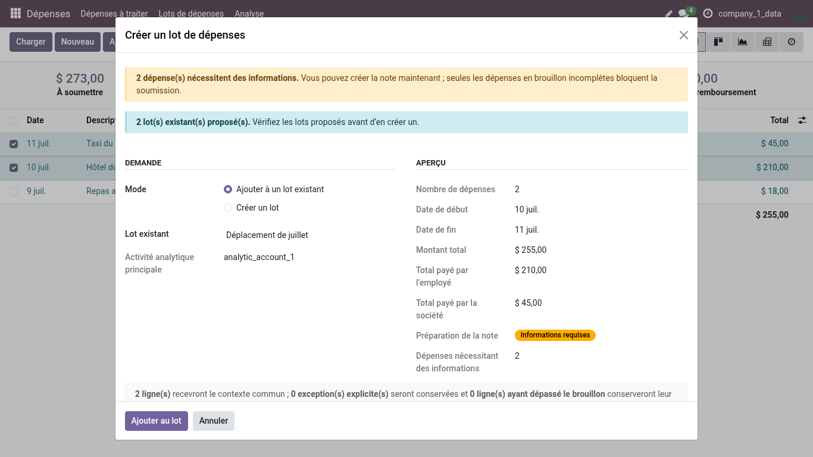
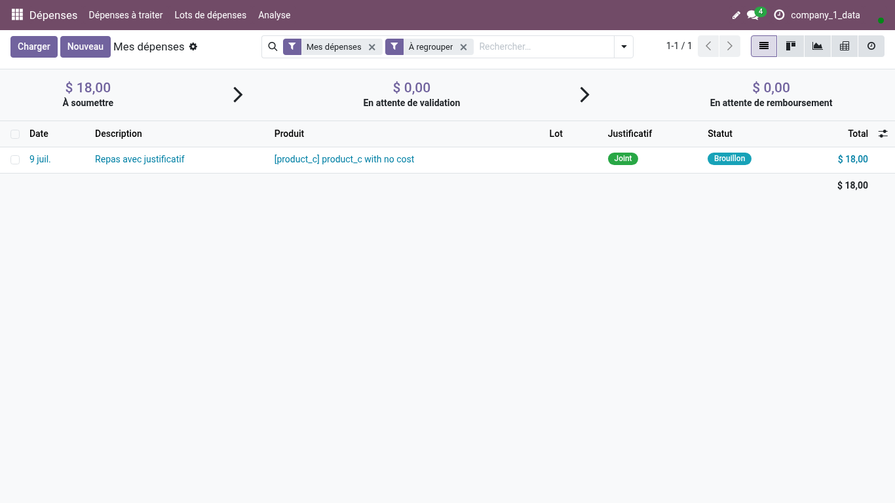

<!-- Generated from the journey named in the front matter. Change the test, then run `make docs`. -->

# Créer ou choisir un lot de dépenses

Réunissez les dépenses d’un même déplacement dans un lot, même si certaines ont été réglées par la société et d’autres par le salarié.

1. Dans **Dépenses > Mes dépenses**, retrouvez les frais du déplacement. Dans cet exemple, il s’agit de l’hôtel et du taxi.

   

2. Cochez la première dépense.

3. Cochez les autres dépenses du déplacement.

4. Cliquez sur **Ajouter à un lot de dépenses**.

5. Vérifiez le lot proposé. Odoo tient compte du salarié, de la société, des dates et de la répartition analytique. Vous pouvez aussi créer un lot.

6. Contrôlez les deux montants de l’aperçu. L’un correspond aux frais avancés par le salarié, l’autre aux frais réglés par la société.

   

7. Confirmez l’ajout au lot.

8. Les dépenses quittent la liste des frais à regrouper. Ouvrez le lot pour les vérifier et les soumettre ensemble.

   
