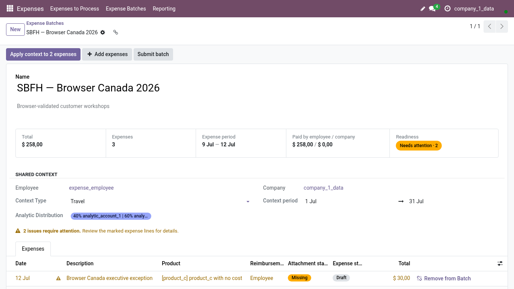
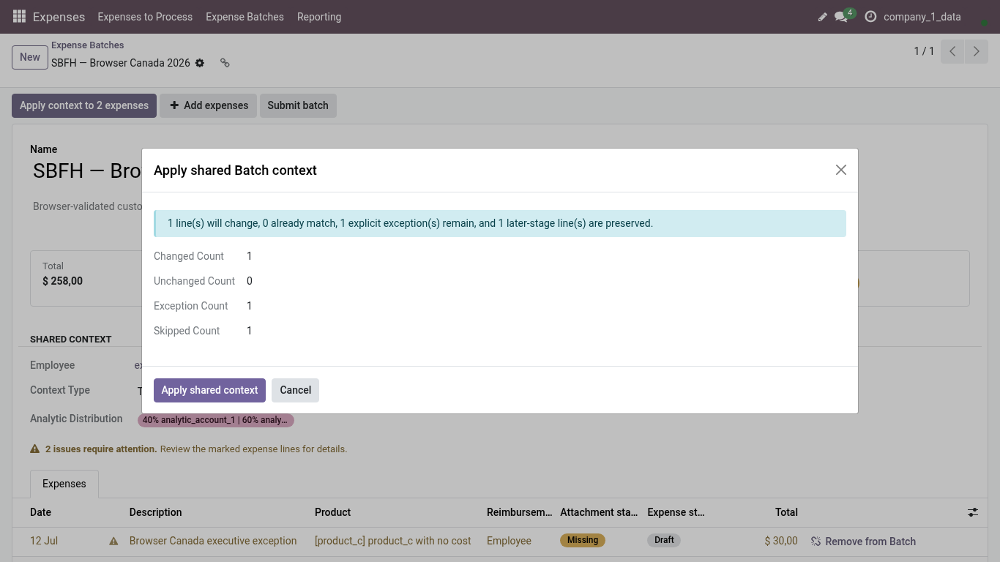
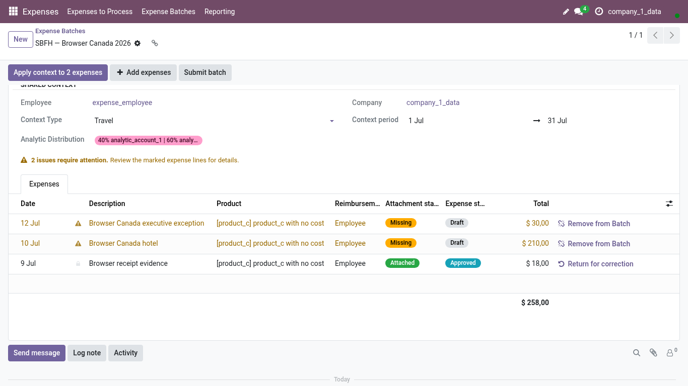

<!-- Generated from the journey named in the front matter. Change the test, then run `make docs`. -->

# Review a Batch before submitting it

Check the batch totals, preview how the saved analytic context will apply, and review any exceptions before submitting.

1. Open **Expenses > Expense Batches** and choose your Batch. The summary at the top totals what you paid and what the company paid; the **Expenses** tab lists the lines.

   

2. Review the saved analytic distribution under **Shared context**. Existing expenses keep their current values until you apply the context.

3. Choose **Apply context to … expenses** to open the preview.

4. Review which drafts will change. Expenses already submitted or approved keep their values, as do drafts with their own allocation unless an authorized reviewer selects them for replacement.

   

5. Choose **Apply shared context** to update the eligible drafts.

6. A line that differs from the Batch is marked with a short helper saying what differs. Open the line to align it, or leave it when the difference is intended.

   

7. Nothing in the list deletes an expense.

8. Use **Remove from Batch** on a draft to return it to your expense list. You can add it to another batch.
