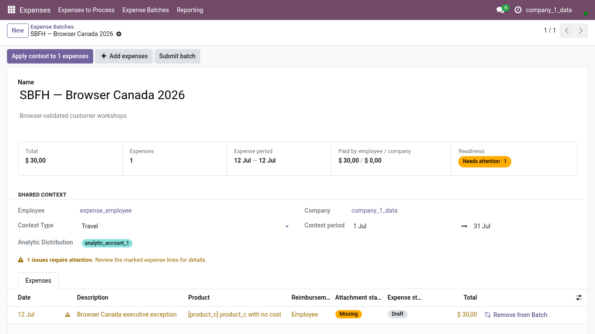
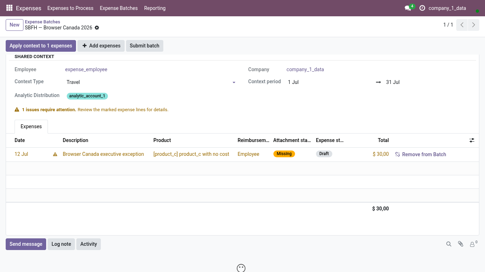

<!-- Generated from the journey named in the front matter. Change the test, then run `make docs`. -->

# Review a Batch before submitting it

Read the Batch summary, fix the shared analytics once, and deal with a line that differs before you submit.

1. Open **Expenses > Expense Batches** and choose your Batch. The summary at the top totals what you paid and what the company paid; the **Expenses** tab lists the lines.

   

2. The analytic distribution of the Batch is shared by its lines. Change it here and every line that follows the Batch follows the change.

3. **Apply context** previews what would change before it changes anything; a line with its own explicit choice is left alone.

4. A line that differs from the Batch is marked with a short helper saying what differs. Open the line to align it, or leave it when the difference is intended.

   

5. Nothing in the list deletes an expense.

6. **Remove from Batch** is the only line action: the expense goes back to your work list unchanged, ready for another Batch.
