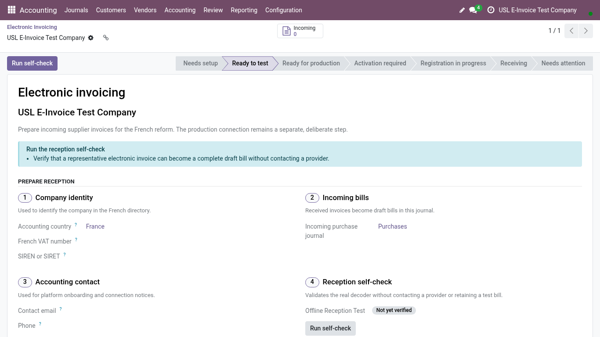
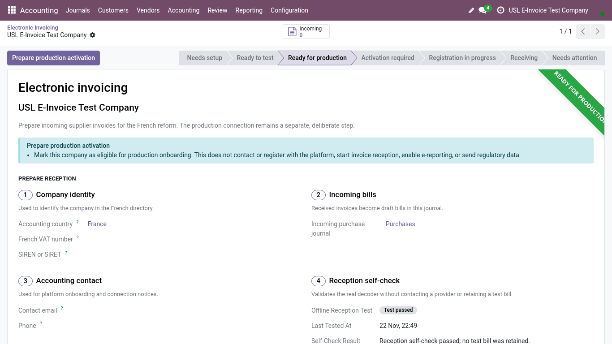

<!-- Generated from the journey named in the front matter. Change the test, then run `make docs`. -->

# Run the electronic-invoice reception self-check

Check a company’s local invoice import with a sample UBL invoice. Live reception is verified separately after activation.

1. Open **Accounting > Configuration > Electronic Invoicing**. Each company you may act in is listed with its reception status. Choose the company.

2. The setup screen gathers what reception needs: the journals, the accounts, the approved platform and the last self-check.

   

3. Choose **Run self-check**. Odoo uses its usual importer to create a temporary draft bill from a sample UBL invoice. It checks the supplier, invoice lines, taxes, total and original file, then rolls back the test records.

4. Odoo keeps the result and the test date. Look for **Test passed** and run the check again after a setup change. Use the [activation guide](activate-electronic-invoice-reception.md) to verify the first live invoice from the approved platform.

   
