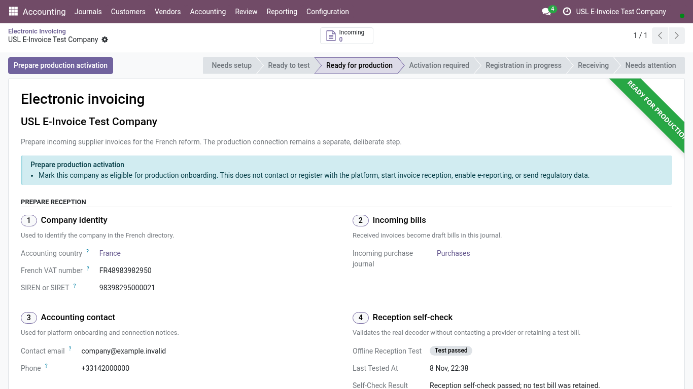

<!-- Generated from the journey named in the front matter. Change the test, then run `make docs`. -->

# Run the electronic-invoice reception self-check

Prove that a company can receive electronic invoices, with a representative invoice that leaves no accounting behind.

1. Open **Accounting > Configuration > Electronic Invoicing**. Each company you may act in is listed with its reception status. Choose the company.

2. The setup screen gathers what reception needs: the journals, the accounts, the approved platform and the last self-check.

   

3. Choose **Run self-check**. Odoo receives a representative electronic invoice through the whole reception path, then discards every record it created.

4. The self-check reads **Test passed**, with when it ran and the confirmation that no test bill was kept. Run it again after any change to the journals, the accounts or the platform.

   
