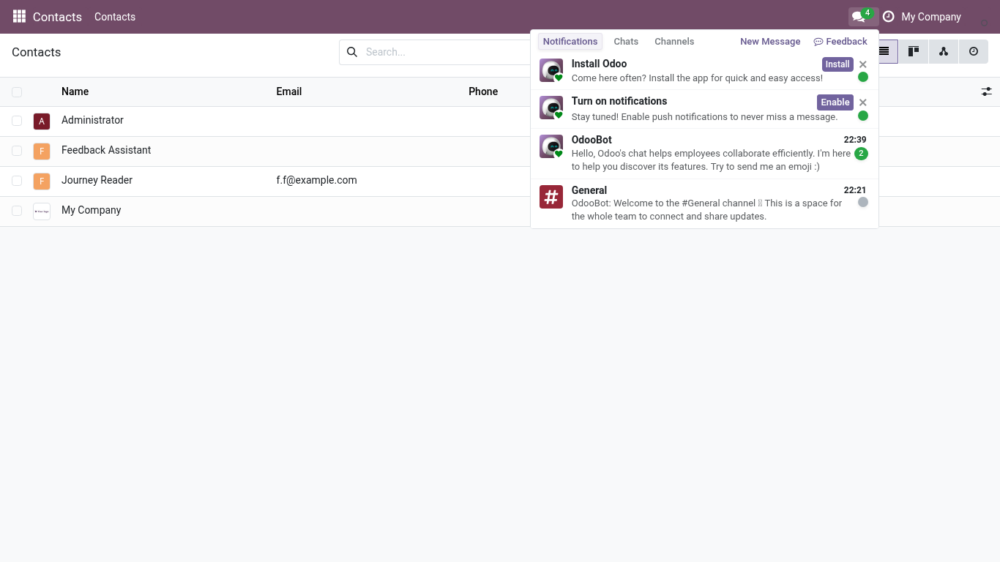
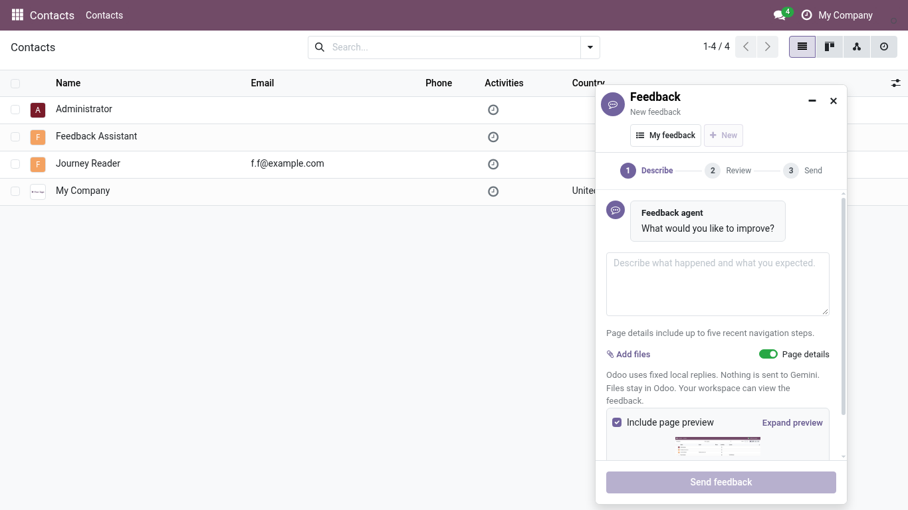
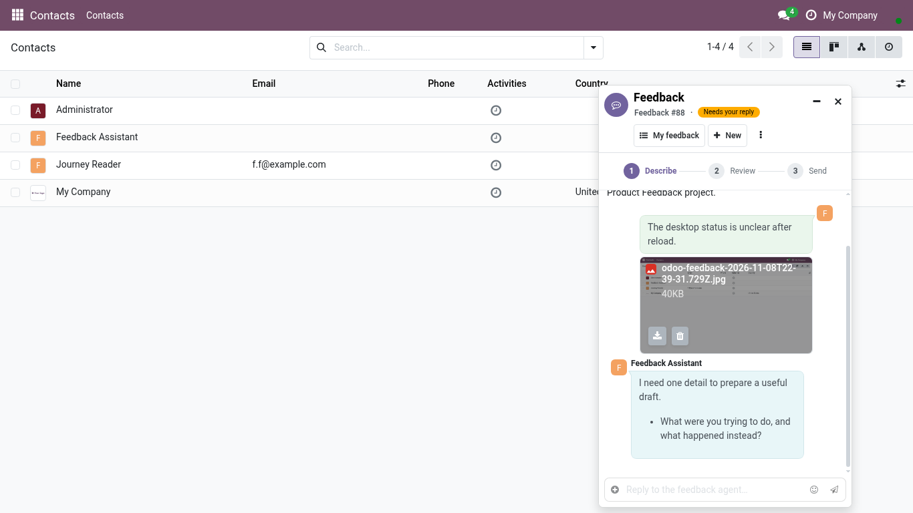
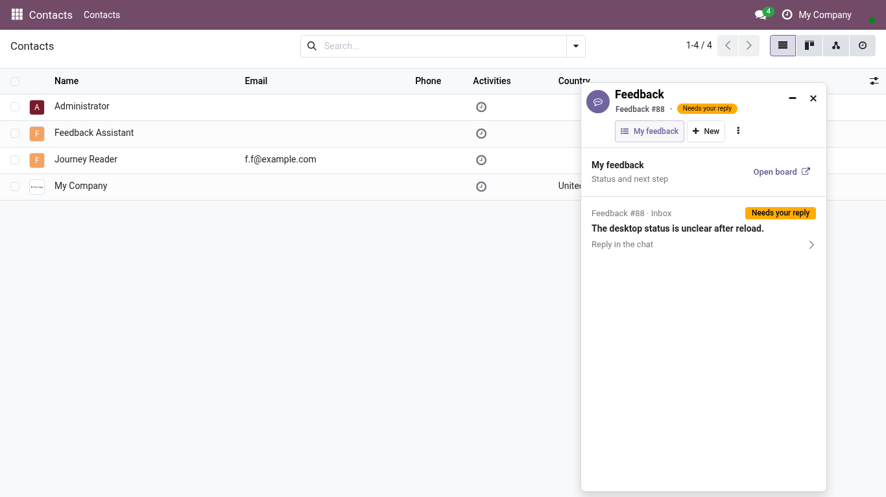

<!-- Generated from the journey named in the front matter. Change the test, then run `make docs`. -->

# Send feedback from any page

Report a problem, suggest an improvement or ask a question without leaving the screen you are on, then follow the answer in My feedback.

1. Open the **Messages** drawer from the top bar. **Feedback** sits beside **New Message** in every tab.

   

2. Choose **Feedback**.

3. The drawer closes and a floating conversation opens, like a chat. Odoo prepares a preview of the page you are on; it stays on your computer until you decide to send it.

   

4. Describe what you saw and what you expected, in your own words. One message is enough; the product team asks if it needs more.

5. **Page details** is ticked when the screen you are on gives useful context: the action, the record you can read, the company and the release, never the address, form values or passwords. Untick it when the page does not matter.

6. Choose **Send feedback**.

7. Your message becomes a card for the product team, and the conversation turns into its chatter: answers and status changes appear here.

   

8. **New** starts another conversation. The card you just sent is kept.

9. **My feedback** lists every card you sent with its current status.

10. Choose a card to reopen its conversation and reply.

11. Come back to **My feedback** at any time from the same drawer to see where each report stands.

   
