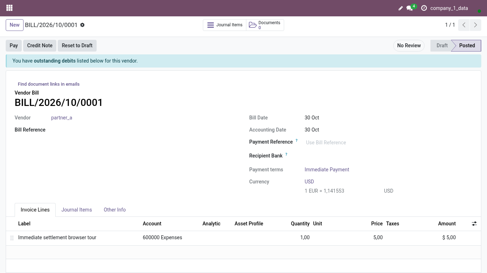
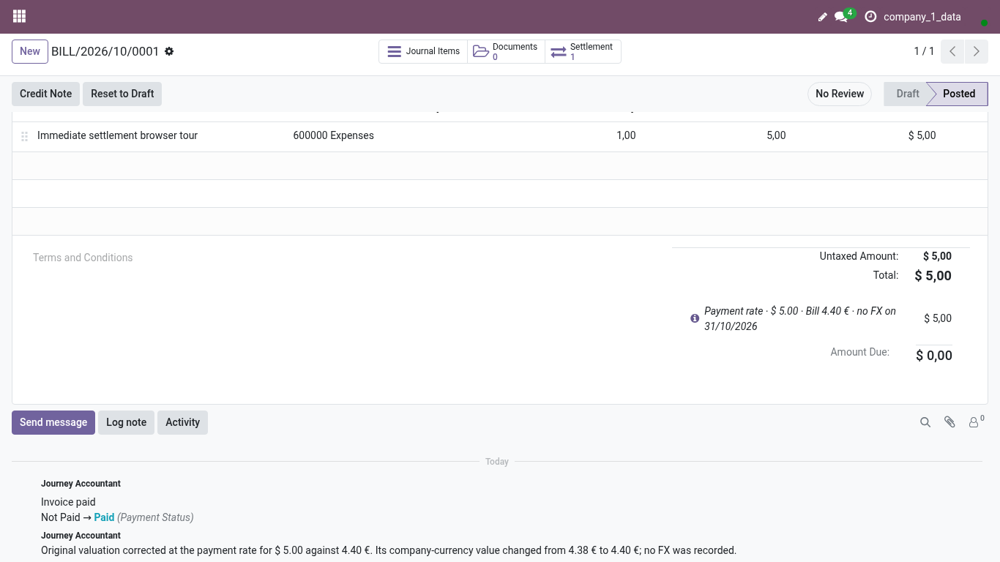
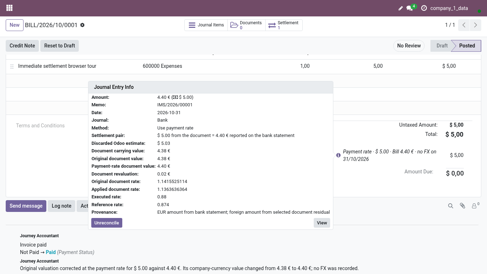

<!-- Generated from the journey named in the front matter. Change the test, then run `make docs`. -->

# Settle a foreign-currency bill at the payment rate

Match a bill in a foreign currency to the company-currency debit the bank reports, value the bill at the rate the payment implies, and undo it if needed.

1. Open the posted bill from **Accounting > Vendors > Bills**. When a bank line of the same partner matches it within the allowed days and rate deviation, the outstanding box offers three actions: the native **Add**, **Settle immediately** and **Use payment rate**, the recommended one in colour.

   

2. **Best match** names the bank line Odoo compared the bill with; open it when you want to see the other candidates.

3. Choose **Use payment rate**. The bill is revalued at the rate the bank payment implies, so no exchange difference is written.

4. The bill is paid and a single line records the settlement: the mechanism, and **no FX** when nothing was booked for the exchange.

   

5. Choose the info icon on the payment line.

6. The detail keeps the facts: what Odoo had estimated and discarded, the original value of the document, its value at the payment rate, and the entries involved.

   

7. **Unreconcile** reverses the whole settlement in one step when the match was wrong.

8. The bill is open again at its original value and the three actions are offered once more.
