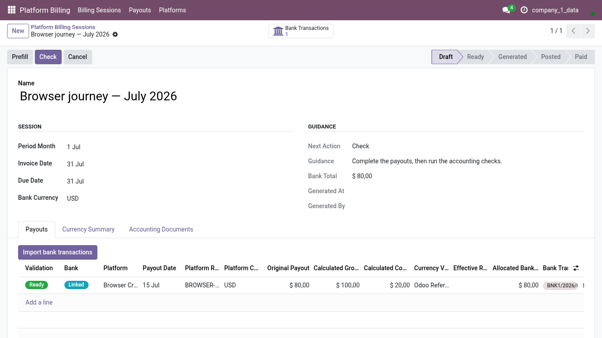
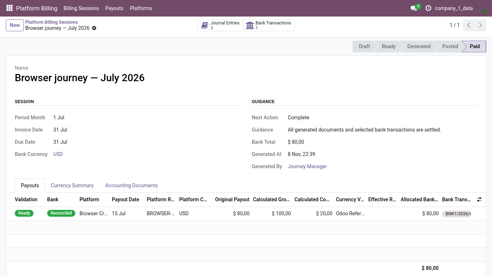
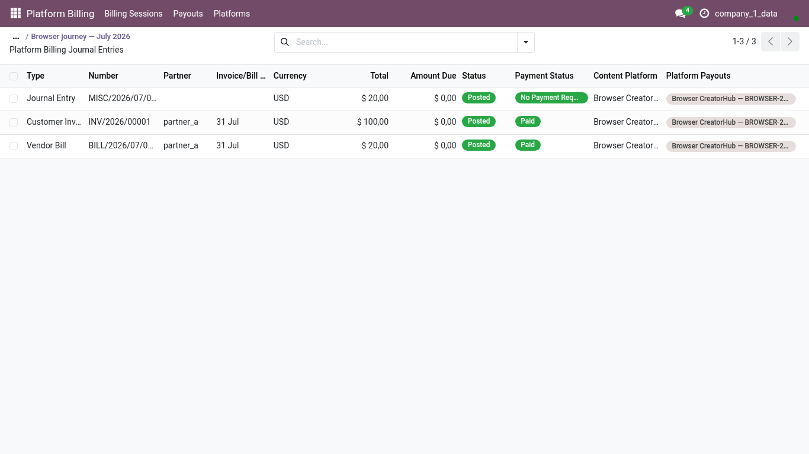

<!-- Generated from the journey named in the front matter. Change the test, then run `make docs`. -->

# Generate, post and reconcile a platform billing session

Take a prepared session from draft to paid: run the preflight, generate and post the documents, and reconcile the bank receipt already matched to the payout.

1. Open **Platform Billing > Billing Sessions** and choose a session in **Draft** whose payouts are entered and whose bank receipt was matched.

   

2. Choose **Check** to run the accounting preflight.

3. Choose **Generate drafts**: the customer invoices and the commission bills are created in draft.

4. Choose **Post documents**. The documents are posted and the commission is compensated against the revenue, so only the net amount is expected from the bank.

5. Choose **Reconcile bank**. The receipt matched to the payout settles the net amount through the bank reconciliation.

6. The session is **Paid**: the invoice, the bill and the bank line agree.

   

7. Choose **Journal Entries** to see what was posted.

8. Every document is a native Odoo journal entry, open to the usual accounting views and reports.

   

9. The compensation entries read **No Payment Required**: they move the commission, they do not expect money.
