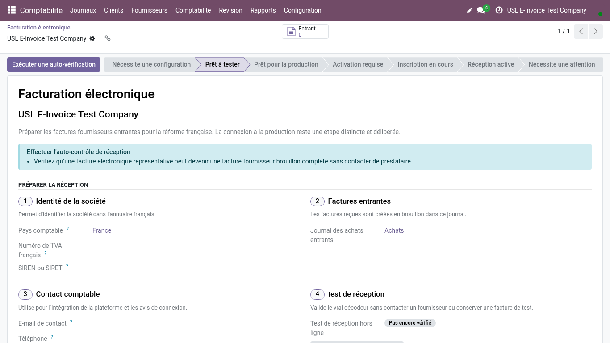
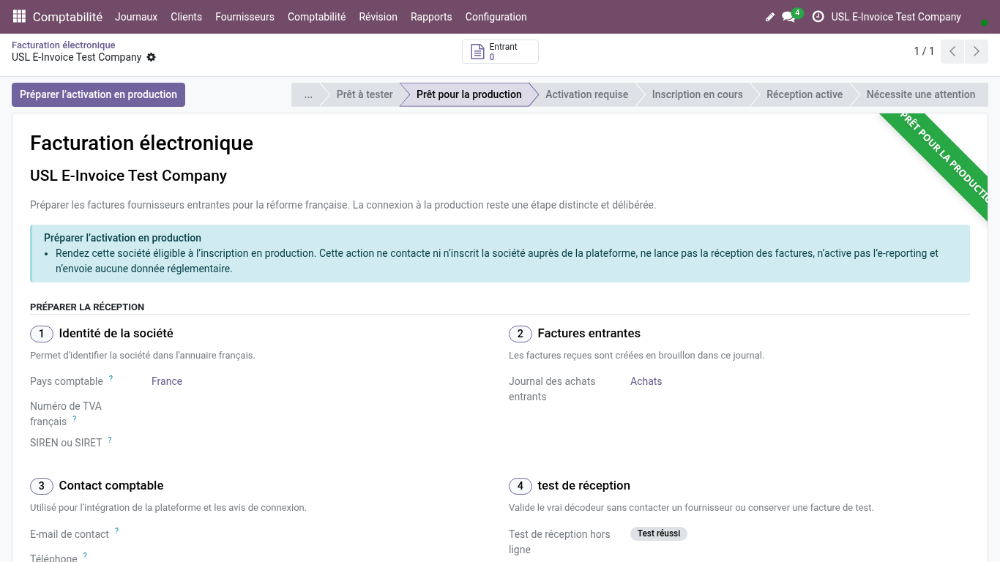

<!-- Generated from the journey named in the front matter. Change the test, then run `make docs`. -->

# Tester la réception des factures électroniques

Vérifiez l’import local d’une facture UBL d’essai dans Odoo. La réception réelle se vérifie séparément, après activation.

1. Dans **Comptabilité > Configuration > Facturation électronique**, ouvrez la société dont vous voulez tester la réception.

2. Vérifiez les journaux, les comptes utilisés et la plateforme agréée. Le résultat du dernier essai figure sur la même fiche.

   

3. Cliquez sur **Exécuter une auto-vérification**. Odoo importe une facture UBL d’essai en brouillon, vérifie le fournisseur, les lignes, les taxes, le total et le fichier original, puis annule la transaction d’essai.

4. Odoo conserve le résultat et la date de l’essai. Vérifiez la mention **Test réussi** et relancez le contrôle après un changement de configuration. Suivez le [guide d’activation (en anglais)](activate-electronic-invoice-reception.md) pour vérifier la première facture reçue de la plateforme agréée.

   
