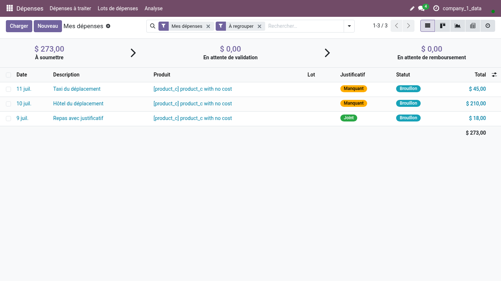
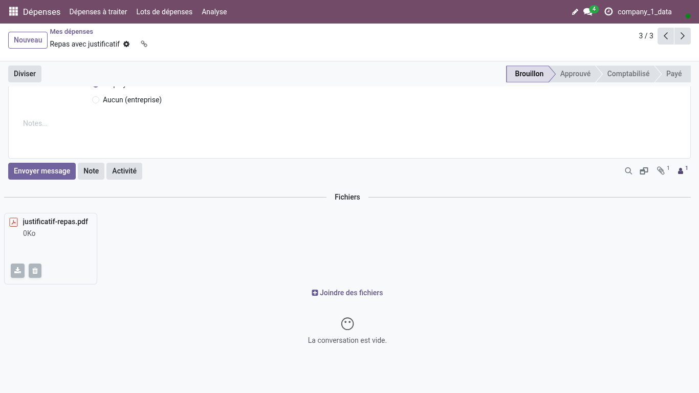

<!-- Generated from the journey named in the front matter. Change the test, then run `make docs`. -->

# Vérifier le justificatif d’une dépense

Retrouvez le reçu joint à une dépense et vérifiez qui a payé avant d’ajouter la dépense à un lot.

1. Ouvrez **Dépenses > Mes dépenses**. Si vous partez d’un nouveau reçu, **Charger** permet de créer la dépense à partir du fichier.

   

2. Ouvrez la dépense à contrôler.

3. Cliquez sur le trombone dans le fil de discussion. Le chiffre indique le nombre de fichiers joints.

4. Sous **Fichiers**, ouvrez le justificatif et vérifiez qu’il est lisible et correspond à cette dépense.

   

5. Vérifiez qui a payé. Une avance personnelle doit être remboursée au salarié. Si la carte de la société a servi, choisissez la société.
