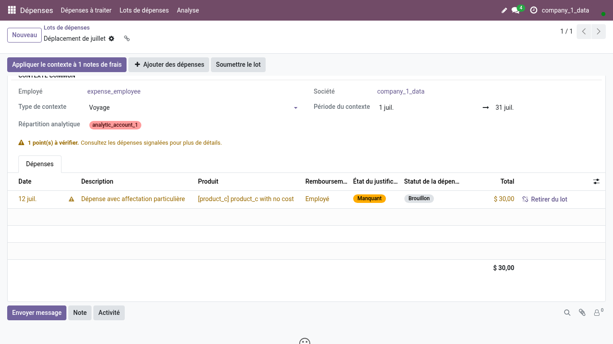

<!-- Generated from the journey named in the front matter. Change the test, then run `make docs`. -->

# Vérifier un lot de dépenses avant de le soumettre

Contrôlez les montants par payeur et repérez les lignes dont la répartition analytique diffère de celle du lot.

1. Dans **Dépenses > Lots de dépenses**, ouvrez votre lot. Le récapitulatif distingue les avances du salarié des frais de la société. L’onglet **Dépenses** en donne le détail.

   

2. Vérifiez la répartition analytique du lot. Une modification s’applique aux lignes qui reprennent cette répartition.

3. Avec **Appliquer le contexte**, consultez l’aperçu avant de confirmer. Une ligne avec une affectation particulière conserve votre choix, sauf si vous demandez son remplacement.

4. Un repère signale une ligne dont l’affectation diffère. Survolez-le pour lire la différence. Ouvrez la ligne pour la corriger si nécessaire.

   

5. Vous pouvez corriger la composition du lot en conservant les dépenses.

6. Cliquez sur **Retirer du lot** pour remettre la dépense dans votre liste. Elle pourra rejoindre un autre lot.
