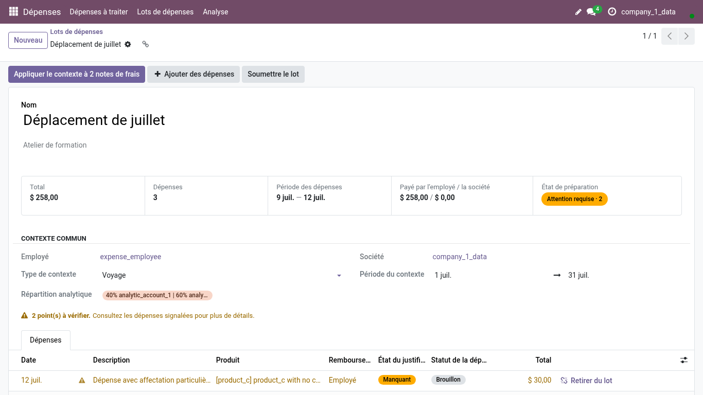
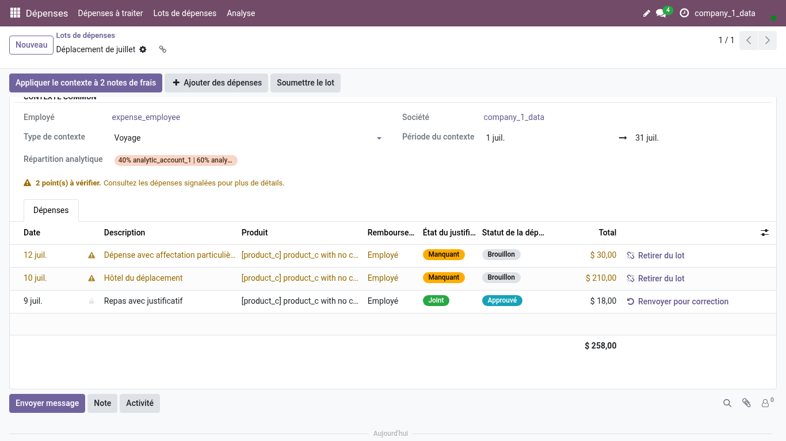

<!-- Generated from the journey named in the front matter. Change the test, then run `make docs`. -->

# Vérifier un lot de dépenses avant de le soumettre

Contrôlez les montants par payeur et repérez les lignes dont la répartition analytique diffère de celle du lot.

1. Dans **Dépenses > Lots de dépenses**, ouvrez votre lot. Le récapitulatif distingue les avances du salarié des frais de la société. L’onglet **Dépenses** en donne le détail.

   

2. Dans **Contexte commun**, enregistrez la nouvelle répartition analytique. Les dépenses existantes gardent leurs valeurs tant que vous n’appliquez pas le contexte.

3. Cliquez sur **Appliquer le contexte à … notes de frais** pour ouvrir l’aperçu.

4. Vérifiez quels brouillons vont changer. Les dépenses déjà soumises ou approuvées gardent leurs valeurs, comme les brouillons qui ont leur propre répartition, sauf si un responsable les sélectionne pour la remplacer.

   

5. Dans l’aperçu, confirmez l’application du contexte commun pour mettre à jour les brouillons concernés.

6. Un repère signale une ligne dont l’affectation diffère. Survolez-le pour lire la différence. Ouvrez la ligne pour la corriger si nécessaire.

   

7. Vous pouvez corriger la composition du lot en conservant les dépenses.

8. Cliquez sur **Retirer du lot** pour remettre la dépense dans votre liste. Elle pourra rejoindre un autre lot.
