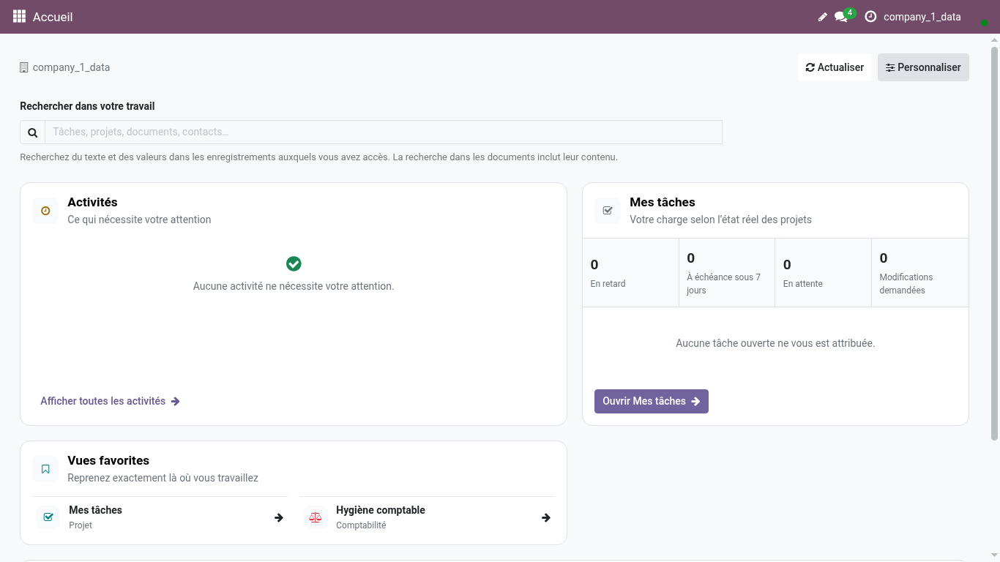
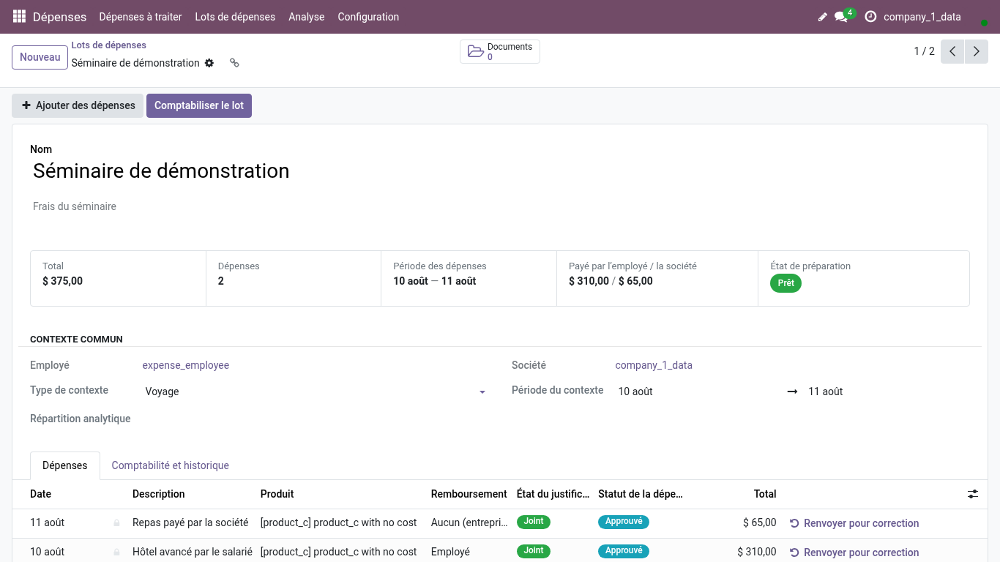
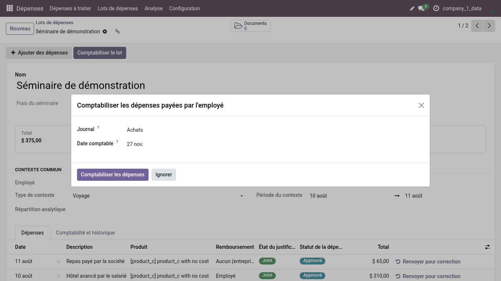
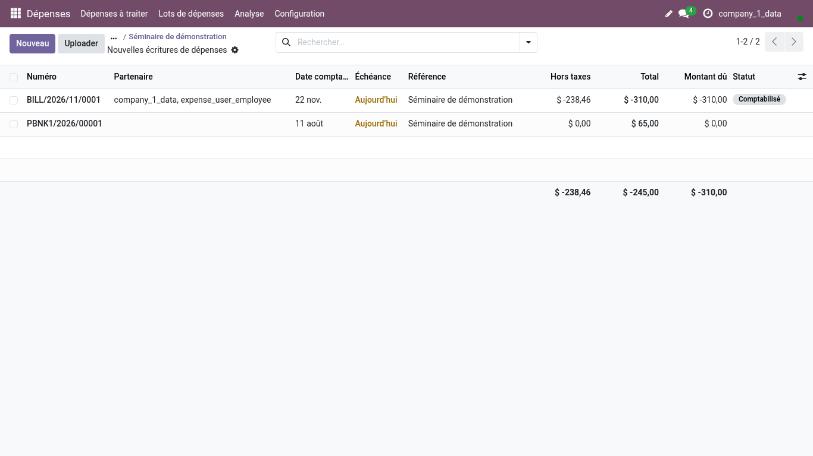

<!-- Generated from the journey named in the front matter. Change the test, then run `make docs`. -->

# De la première connexion au premier lot de dépenses comptabilisé

Entraînez-vous sur un déplacement approuvé. Comptabilisez les frais payés par la société et l’avance du salarié, puis retrouvez les deux écritures.

1. Utilisez une base de formation avec un lot approuvé et un compte autorisé à comptabiliser les dépenses. Connectez-vous avec votre compte habituel. Vous arrivez sur **Accueil**.

   

2. Ouvrez le menu des applications en haut à gauche.

3. Ouvrez **Dépenses**. Dans cet exemple, le salarié a avancé les frais d’hôtel et la société a réglé le repas.

4. Ouvrez **Lots de dépenses**. Repérez le déplacement approuvé qui vous sert d’exercice.

5. Ouvrez **Séminaire de démonstration**, ou le lot équivalent dans votre base de formation.

6. Lisez le récapitulatif avant de comptabiliser. Repérez qui a payé chaque dépense et gardez les deux montants en tête pour la suite.

   

7. Cliquez sur **Comptabiliser le lot**. Odoo comptabilise les frais payés par la société et ouvre une confirmation distincte pour la somme avancée par le salarié.

   

8. Vérifiez le journal et la date comptable, puis cliquez sur **Comptabiliser les dépenses** pour enregistrer la part du salarié.

9. Vous venez de comptabiliser votre premier lot. Comparez les montants des deux écritures avec le récapitulatif. Vous retrouvez séparément la dépense payée par la société et la somme à rembourser au salarié.

   
