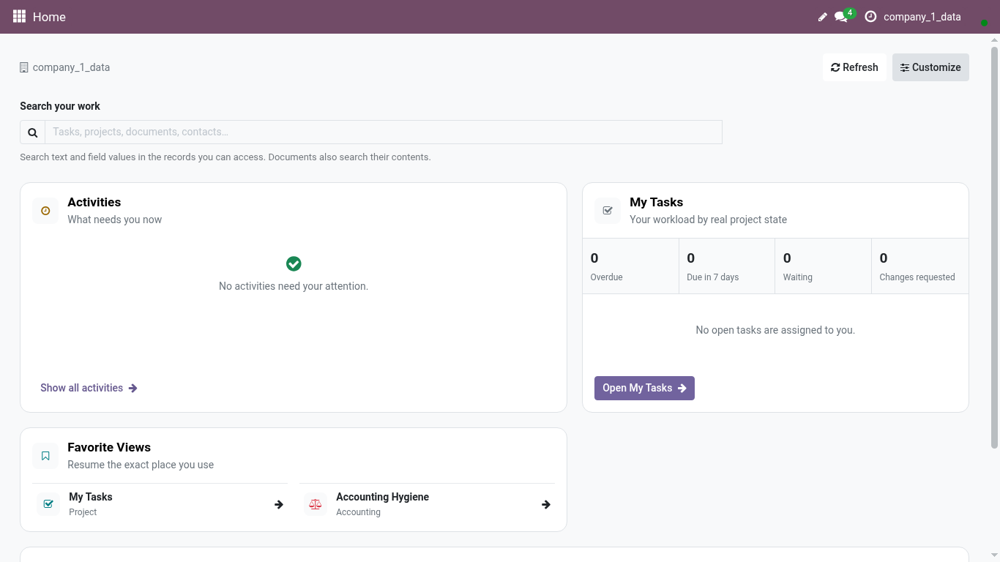
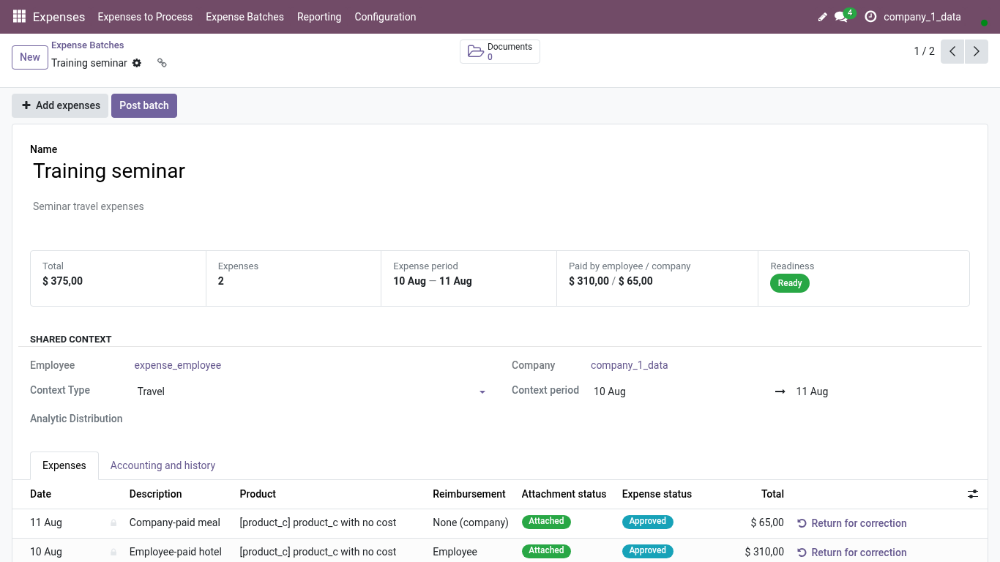
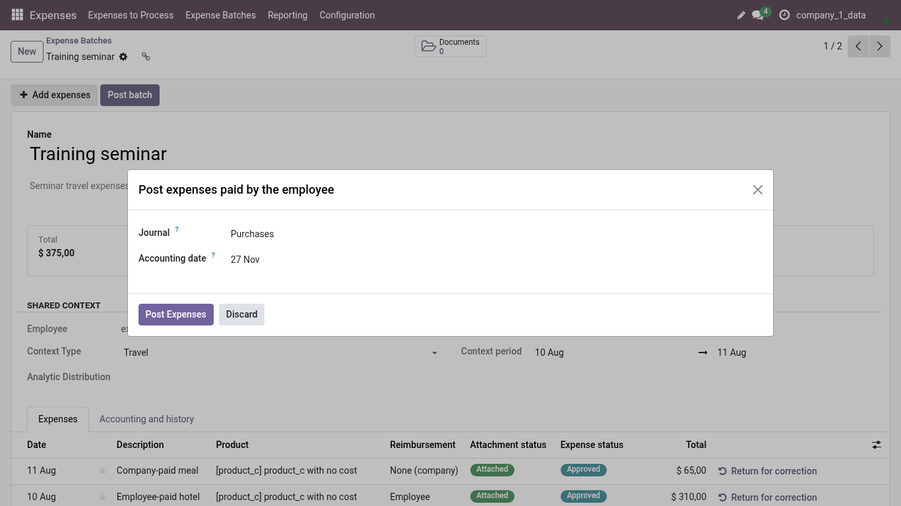
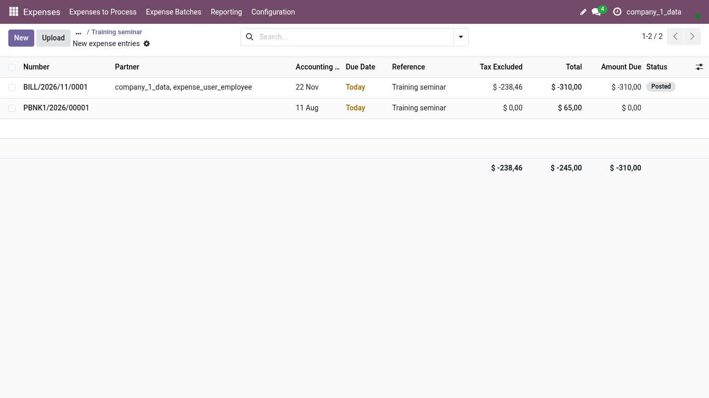

<!-- Generated from the journey named in the front matter. Change the test, then run `make docs`. -->

# From your first sign-in to your first posted expense batch

Learn on an approved training trip. Post the part paid by the company and the part paid by the employee, then find both journal entries.

1. Use a training workspace with an approved expense batch and permission to post expenses. Sign in with your usual company account. You arrive on **Home**.

   

2. Choose the application menu in the upper-left corner.

3. Open **Expenses**. You will work with an example that combines a hotel paid by the employee and a meal paid by the company.

4. Open **Expense Batches**. Find the approved training trip prepared for you.

5. Open **Training seminar**, or the equivalent example in your training workspace.

6. Read the summary before posting. Identify who paid for each expense and follow the amounts through the next screens.

   

7. Choose **Post Batch**. Odoo posts the company-paid expense and opens a separate confirmation for the amount the employee advanced.

   

8. Check the journal and accounting date, then choose **Post Expenses** to record the employee-paid expense.

9. You have posted your first batch. Compare the two amounts shown with the summary. The company charge and the employee reimbursement each have their own entry.

   
